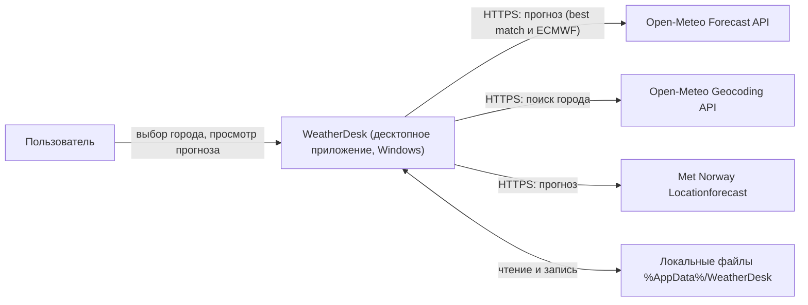
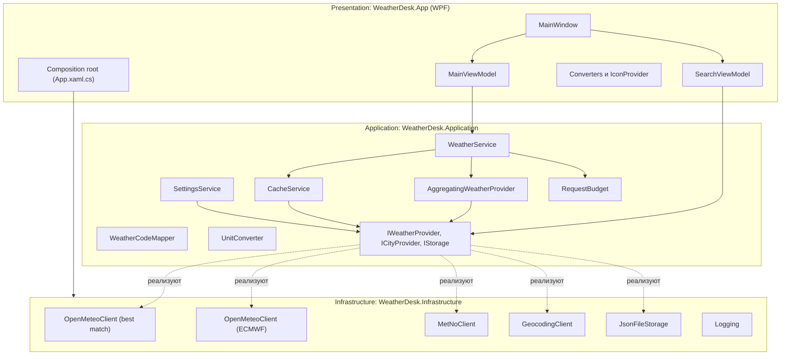
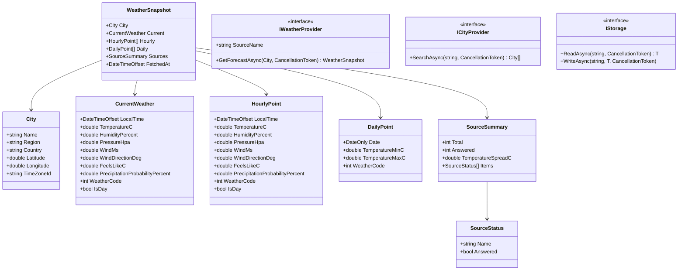
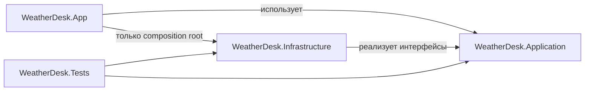
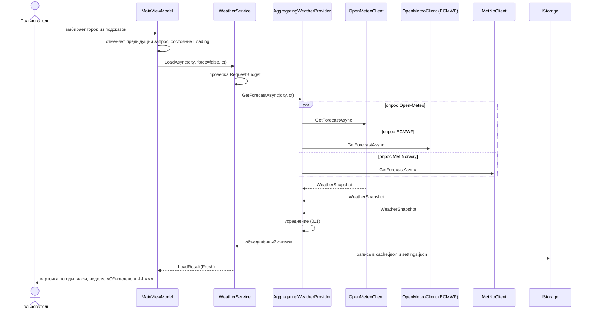
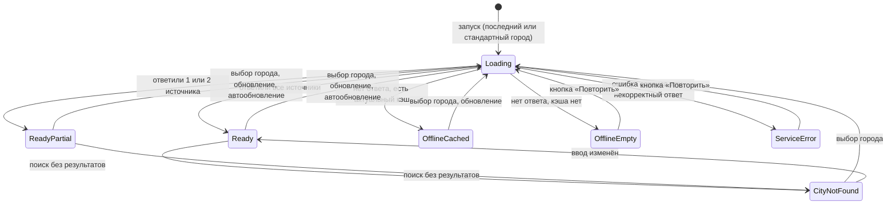
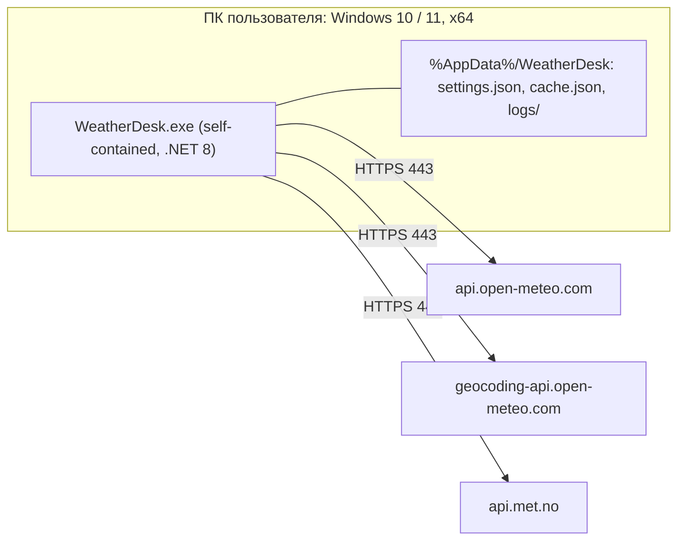

# Описание дизайна программного обеспечения

Для приложения «WeatherDesk» (десктопное приложение прогноза погоды)

Версия 0.3

Подготовил Бавбель С.Л., гр. 450501

БГУИР, кафедра электронных вычислительных машин

01.12.2026

## Оглавление

<!-- TOC -->
* [1. Введение](#1-introduction)
  * [1.1 Назначение документа](#11-document-purpose)
  * [1.2 Область применения](#12-subject-scope)
  * [1.3 Определения, акронимы и сокращения](#13-definitions-acronyms-and-abbreviations)
  * [1.4 Ссылки](#14-references)
  * [1.5 Обзор документа](#15-document-overview)
* [2. Обзор дизайна](#2-design-overview)
  * [2.1 Задачи стейкхолдеров](#21-stakeholder-concerns)
  * [2.2 Выбранные точки зрения](#22-selected-viewpoints)
    * [2.2.1 Контекст](#221-context)
    * [2.2.2 Композиция](#222-composition)
    * [2.2.3 Логическое представление](#223-logical)
    * [2.2.4 Физическое представление](#224-physical)
    * [2.2.5 Структура](#225-structure)
    * [2.2.6 Зависимости](#226-dependency)
    * [2.2.7 Информация](#227-information)
    * [2.2.8 Интерфейс](#228-interface)
    * [2.2.9 Взаимодействие](#229-interaction)
    * [2.2.10 Алгоритм](#2210-algorithm)
    * [2.2.11 Динамика состояний](#2211-state-dynamics)
    * [2.2.12 Параллелизм](#2212-concurrency)
    * [2.2.13 Паттерны](#2213-patterns)
    * [2.2.14 Развёртывание](#2214-deployment)
    * [2.2.15 Ресурсы](#2215-resources)
* [3. Проектные представления](#3-design-views)
* [4. Решения](#4-decisions)
* [5. Приложения](#5-appendixes)
<!-- TOC -->

## История изменений

| Name | Date | Reason For Changes | Version |
|------|------|--------------------|---------|
| С.Л. Бавбель | 11.11.2026 | Первая редакция по SRS v0.1 | 0.1 |
| С.Л. Бавбель | 12.11.2026 | Добавлено приложение D (системные требования с приоритетами 10–50); по итогам первого раунда обсуждения изменены приоритеты, кэш, избранное и клавиатура перенесены в версию 1.1, ADR-0003 принят | 0.2 |
| С.Л. Бавбель | 01.12.2026 | По итогам второго раунда: добавлены дополнительные показатели и тёмная тема (SYS-FUNC-015, SYS-FUNC-018), обновлены представления 003, 007, 011, 018 и приложения A, C, D | 0.3 |

---

## 1. Введение {#1-introduction}

Документ описывает проектное решение для десктопного приложения «WeatherDesk»: из каких частей оно состоит, как они взаимодействуют, какие данные хранятся и какие алгоритмы используются. Каждое проектное представление связано с требованиями SRS, которые оно реализует, и с решениями из раздела 4.

### 1.1 Назначение документа {#11-document-purpose}

SDD отвечает на вопрос, **как** будет реализовано то, что в SRS v0.1 определено как «что». Документ предназначен для разработчика (реализация по готовому проекту), тестировщика (точки подмены зависимостей и проверяемые контракты), Заказчика (понимание принятых решений и их последствий для сроков) и преподавателя (трассируемость от требований к дизайну). Документ используется после согласования SRS и обновляется при каждом изменении требований. Связанные документы: SRS (`srs.md`), протоколы архитектурных решений (`adr/`).

### 1.2 Область применения {#12-subject-scope}

**Система:** «WeatherDesk», версия 0.1 — самостоятельное десктопное приложение для Windows 10/11 на C# (.NET 8), без собственного сервера. Приложение позволяет выбрать город и посмотреть текущую погоду, прогноз по часам на 24 часа и прогноз на 7 дней. Данные запрашиваются параллельно у трёх внешних сервисов (Open-Meteo, Open-Meteo с моделью ECMWF и Met Norway), показываются усреднённые значения, а также число ответивших источников и разброс температуры. Интерфейс адаптируется к ширине окна, прогнозы сохраняются в локальном кэше для работы без сети (кэш и избранные города запланированы на версию 1.1).

**Входит в SDD:** всё приложение целиком: слои Presentation, Application, Infrastructure, локальное хранилище, взаимодействие с внешними API, развёртывание в виде ZIP-архива.

**Не входит в SDD:** визуальный дизайн экранов (макеты в SRS, рисунки 3–5), настройка конвейера CI, подробные тест-кейсы (раздел 4 SRS). Серверной части у системы нет.

Соответствие бизнес-целям SRS: BO-1 и BO-2 (быстрый показ прогноза) — представления 009, 011, 014; BO-3 (адаптивность) — 018; BO-4 (без сервера и ключей) — 001, 016; BO-5 (замена источника данных) — 002, 005, 015.

### 1.3 Определения, акронимы и сокращения {#13-definitions-acronyms-and-abbreviations}

| Term | Definition |
|------|------------|
| ADR | Architecture Decision Record — протокол архитектурного решения |
| API | Application Programming Interface — набор определений и протоколов для создания и интеграции прикладного ПО |
| Composition root | Единственное место приложения, где создаются объекты и связываются зависимости |
| DI | Dependency Injection — внедрение зависимостей |
| DTO | Data Transfer Object — объект для разбора ответа внешнего сервиса |
| IANA | Идентификатор часового пояса вида `Europe/Minsk` |
| MSL | Mean Sea Level — давление, приведённое к уровню моря (`pressure_msl`) |
| MVVM | Model–View–ViewModel — шаблон разделения интерфейса и логики |
| SDD | Software Design Document — документ, описывающий дизайн ПО |
| SRS | Software Requirements Specification — спецификация требований к ПО |
| WMO-код | Числовой код погодных условий по стандарту ВМО; таблица соответствия иконкам — приложение C SRS |
| WPF | Windows Presentation Foundation — библиотека построения интерфейса для Windows |
| Агрегатор | Компонент `AggregatingWeatherProvider`, объединяющий ответы нескольких источников |
| Источник | Один внешний погодный сервис, подключённый через реализацию `IWeatherProvider` |
| Снимок прогноза | Неизменяемый объект `WeatherSnapshot` с текущей погодой, почасовым и дневным прогнозом |

### 1.4 Ссылки {#14-references}

| № | Источник | Тип | Расположение |
|---|----------|-----|--------------|
| 1 | SRS «WeatherDesk», версия 0.1 | Нормативная | `srs.md` |
| 2 | ADR-0001 … ADR-0005 | Нормативная | `adr/` |
| 3 | Шаблон SDD | Справочная | `Templates/sdd/sdd-template.md` |
| 4 | Open-Meteo: Weather Forecast API | Нормативная | https://open-meteo.com/en/docs |
| 5 | Open-Meteo: Geocoding API | Нормативная | https://open-meteo.com/en/docs/geocoding-api |
| 6 | Met Norway: Locationforecast API | Нормативная | https://api.met.no/weatherapi/locationforecast/2.0/documentation |
| 7 | Графические модели SysML v2 из SRS | Справочная | `diagrams/` |

### 1.5 Обзор документа {#15-document-overview}

Раздел 2 определяет стейкхолдеров и выбранные точки зрения. Раздел 3 содержит проектные представления с идентификаторами вида `001-context`; у каждого указаны точка зрения, представление (диаграмма или текст) и связанные требования SRS и решения. В разделе 4 перечислены архитектурные решения со ссылками на полные ADR. Раздел 5 содержит трассировку «требование → представление» (приложение A), замечания к SRS (приложение B), точки расширения (приложение C) и системные требования с приоритетами 10–50 (приложение D). Диаграммы записаны в нотации Mermaid и отображаются на GitHub. Изменения фиксируются в истории изменений.

---

## 2. Обзор дизайна {#2-design-overview}

Приложение построено как слоистое (Presentation, Application, Infrastructure, как требует REQ-MAINT-001) приложение по шаблону MVVM на WPF. Все внешние источники данных скрыты за интерфейсом `IWeatherProvider`, поэтому интерфейс не зависит от конкретного сервиса, а объединение трёх источников выполняется компонентом, который сам реализует этот же интерфейс. Прогнозы приходят одним неизменяемым объектом, что упрощает обновление интерфейса и тестирование. Состояние экрана описывается явным конечным автоматом.

### 2.1 Задачи стейкхолдеров {#21-stakeholder-concerns}

| Стейкхолдер | Основные задачи | Точки зрения и представления |
|-------------|-----------------|------------------------------|
| Пользователь | Быстро получить понятный прогноз; удобная работа в окнах разного размера; понятные сообщения при сбоях | Интерфейс (018), Динамика состояний (013), Взаимодействие (009, 010) |
| Заказчик | Соответствие требованиям, три источника данных, соблюдение сроков и бюджета, понятность решений | Контекст (001), Решения (раздел 4), Приложение A |
| Разработчик | Понятная структура, простая замена источника данных, возможность расширения | Композиция (002), Логическое (003), Зависимости (006), Паттерны (015) |
| Тестировщик | Проверяемость, возможность подменить внешние сервисы тестовыми данными | Интерфейс (008), Алгоритм (011, 012), Параллелизм (014) |
| Преподаватель | Трассируемость требований, обоснованность решений | Приложение A, раздел 4 |
| Сопровождающий / оператор | Журнал ошибок, лицензии, простая поставка и удаление | Развёртывание (016), Ресурсы (017), Информация (007) |

### 2.2 Выбранные точки зрения {#22-selected-viewpoints}

Выбраны все 15 точек зрения шаблона: для небольшого приложения часть из них описывается кратко. Для каждой указано, какие задачи она адресует и в каком представлении раздела 3 применена.

#### 2.2.1 Контекст {#221-context}

Показывает WeatherDesk как «чёрный ящик»: пользователь, три погодных сервиса, сервис геокодинга и локальные файлы. Адресует границы системы и отсутствие собственного сервера (BO-4, CON-3). Применено в представлении **001-context**.

#### 2.2.2 Композиция {#222-composition}

Описывает деление на слои и компоненты и места интеграции внешних компонентов. Адресует модульность и замену источника данных (REQ-MAINT-001, REQ-MAINT-003). Применено в **002-composition**.

#### 2.2.3 Логическое представление {#223-logical}

Фиксирует доменные типы (город, снимок прогноза, точки часового и дневного прогноза) и интерфейсы слоя Application. Применено в **003-logical**.

#### 2.2.4 Физическое представление {#224-physical}

Описывает физическое окружение: обычный ПК с Windows и доступом в Интернет. Специальной аппаратуры нет (SRS, 3.1.2). Применено в **004-physical**.

#### 2.2.5 Структура {#225-structure}

Показывает внутреннее устройство самых сложных компонентов: агрегатора источников и клиента одного источника. Применено в **005-structure**.

#### 2.2.6 Зависимости {#226-dependency}

Показывает направление зависимостей между проектами решения. Ограничение: ViewModel не обращается к Infrastructure (REQ-MAINT-001). Применено в **006-dependency**.

#### 2.2.7 Информация {#227-information}

Описывает структуру постоянных данных: `settings.json`, `cache.json`, журнал. Применено в **007-information**.

#### 2.2.8 Интерфейс {#228-interface}

Специфицирует контракты между слоями (`IWeatherProvider`, `ICityProvider`, `IStorage`, `WeatherService`) и обращения к внешним API. Применено в **008-interface**.

#### 2.2.9 Взаимодействие {#229-interaction}

Показывает порядок сообщений при выборе города и пути отказов. Применено в **009-interaction-load** и **010-interaction-failures**.

#### 2.2.10 Алгоритм {#2210-algorithm}

Детализирует алгоритм усреднения данных трёх источников, преобразование единиц и кодов погоды, ограничение частоты запросов. Применено в **011-algorithm-aggregation** и **012-algorithm-units-and-codes**.

#### 2.2.11 Динамика состояний {#2211-state-dynamics}

Описывает состояния экрана и переходы между ними (REQ-INT-005, рисунок 7 SRS). Применено в **013-state-dynamics**.

#### 2.2.12 Параллелизм {#2212-concurrency}

Описывает параллельный опрос источников, отмену устаревших запросов, защиту файлов от одновременной записи. Применено в **014-concurrency**.

#### 2.2.13 Паттерны {#2213-patterns}

Фиксирует применённые паттерны и места их применения. Применено в **015-patterns**.

#### 2.2.14 Развёртывание {#2214-deployment}

Описывает, как приложение поставляется и где хранит данные на компьютере пользователя. Применено в **016-deployment**.

#### 2.2.15 Ресурсы {#2215-resources}

Описывает ограничения на размеры файлов, число запросов и использование сетевых соединений. Применено в **017-resources**.

---

## 3. Проектные представления {#3-design-views}

Идентификаторы вида `ННН-название` используются для ссылок из других разделов. В каждом представлении указаны реализуемые требования SRS (REQ-…) и связанные решения (ADR-…).

### 001-context — Контекст системы

- **ID**: 001-context
- **Title**: Контекст приложения WeatherDesk
- **Viewpoint**: Контекст
- **Representation**:



Приложение предоставляет пользователю следующие услуги: поиск и выбор города, текущая погода, прогноз по часам и на неделю, переключение единиц давления, обновление данных, работу без сети по кэшу. Собственного сервера и базы данных нет.

- **More Information**: SRS 2.1, рисунки 1–2 SRS; CON-3, CON-4, CON-8, REQ-SEC-001, REQ-SEC-003.

### 002-composition — Состав и слои приложения

- **ID**: 002-composition
- **Title**: Композиция приложения из слоёв и компонентов
- **Viewpoint**: Композиция
- **Representation**:



Функциональное деление: поиск города (`SearchViewModel`, `GeocodingClient`), получение и объединение прогноза (`WeatherService`, `AggregatingWeatherProvider`, клиенты), хранение (`SettingsService`, `CacheService`, `JsonFileStorage`), отображение (ViewModel, конвертеры, иконки). Рантайм-деление: один процесс, один поток интерфейса и пул потоков для ввода-вывода.

- **More Information**: REQ-MAINT-001, REQ-MAINT-003, REQ-INT-009; решения: ADR-0001, ADR-0002.

### 003-logical — Доменные типы и интерфейсы

- **ID**: 003-logical
- **Title**: Логическая модель: типы слоя Application
- **Viewpoint**: Логическое представление
- **Representation**:



Все числовые поля допускают отсутствие значения (`null`); в интерфейсе вместо отсутствующего значения показывается «—» (REQ-REL-002). Типы снимка неизменяемые (`record`). Поля `WindDirectionDeg`, `FeelsLikeC` и `PrecipitationProbabilityPercent` добавлены в версии 0.3 (SYS-FUNC-015).

- **More Information**: REQ-FUNC-006 … REQ-FUNC-010, REQ-REL-002, REQ-MAINT-001.

### 004-physical — Физическое окружение

- **ID**: 004-physical
- **Title**: Физическое окружение приложения
- **Viewpoint**: Физическое представление
- **Representation**: Приложение выполняется на одном персональном компьютере пользователя: 64-разрядная Windows 10 (22H2) или Windows 11, экран не менее 1024×768 (AS-4), масштаб 100–200%. Для работы нужно подключение к Интернету по HTTPS (порт 443); без него приложение показывает кэш (REQ-INT-005). Другого оборудования нет.
- **More Information**: SRS 3.1.2, REQ-PORT-001, AS-1, AS-4.

### 005-structure — Внутреннее устройство ключевых компонентов

- **ID**: 005-structure
- **Title**: Внутренняя структура агрегатора и клиента источника
- **Viewpoint**: Структура
- **Representation**:



```mermaid
flowchart LR
    subgraph C["Клиент одного источника (например, MetNoClient)"]
        direction LR
        RB1["RequestBudget (проверка лимита)"] --> HC["HttpClient (общий экземпляр, таймаут 10 с)"]
        HC --> DTO["Разбор JSON в DTO"]
        DTO --> MP["Преобразователь DTO в WeatherSnapshot"]
    end
    subgraph G["AggregatingWeatherProvider"]
        direction LR
        Q["Параллельный опрос источников"] --> R["Список результатов: снимок или ошибка"]
        R --> M["Слияние и усреднение (алгоритм 011)"]
        M --> S["Снимок с SourceSummary"]
    end
    C -->|"реализует IWeatherProvider"| G
```

Клиент каждого источника сам приводит ответ к единому формату: переводит время к местному, единицы к °C, гПа и м/с, а коды погоды к WMO. Агрегатор ничего не знает о форматах внешних сервисов и работает только с `WeatherSnapshot`.

- **More Information**: REQ-MAINT-003, REQ-REL-002, REQ-SEC-001; решение: ADR-0002.

### 006-dependency — Зависимости между проектами

- **ID**: 006-dependency
- **Title**: Граф зависимостей проектов решения
- **Viewpoint**: Зависимости
- **Representation**:



Внешние пакеты: стандартная библиотека .NET 8 (`System.Net.Http`, `System.Text.Json`), `Microsoft.Extensions.DependencyInjection`, библиотека журналирования с ротацией файлов (Serilog), xUnit для тестов. Лицензии всех пакетов перечисляются в `docs/licenses.md` (REQ-COMP-002).

- **More Information**: REQ-MAINT-001, REQ-MAINT-002, REQ-COMP-002.

### 007-information — Постоянные данные

- **ID**: 007-information
- **Title**: Структура локальных данных
- **Viewpoint**: Информация
- **Representation**: Каталог `%AppData%/WeatherDesk`, кодировка UTF-8.

| Файл | Содержимое | Правила |
|------|------------|---------|
| `settings.json` | Единица давления, тема оформления (светлая или тёмная), настройка «Запоминать последний город», последний город, избранные города (до 10, версия 1.1) | Версия схемы `schemaVersion`; при повреждении переименовывается в `settings.json.bad`, приложение использует значения по умолчанию |
| `cache.json` | Последние снимки прогноза для 10 городов | Ключ: координаты с округлением до 2 знаков; вытеснение самой старой записи; срок хранения 24 часа (OQ-7); при повреждении переименовывается в `cache.json.bad` |
| `logs/app.log` | Журнал ошибок | Не более 1 МБ в файле, не более 3 файлов (REQ-OBS-001) |

Пример `settings.json`:

```json
{
  "schemaVersion": 1,
  "pressureUnit": "mmHg",
  "theme": "light",
  "rememberLastCity": true,
  "lastCity": {
    "name": "Гродно", "region": "Гродненская область", "country": "Беларусь",
    "latitude": 53.67, "longitude": 23.83, "timeZoneId": "Europe/Minsk"
  },
  "favorites": []
}
```

Пример `cache.json` (сокращённо):

```json
{
  "schemaVersion": 1,
  "entries": [
    {
      "cityKey": "53.90,27.57",
      "fetchedAtUtc": "2026-11-11T09:20:00Z",
      "snapshot": { "city": { }, "current": { }, "hourly": [ ], "daily": [ ], "sources": { } }
    }
  ]
}
```

Значения давления в кэше и в снимке хранятся в гПа (давление на уровне моря, ADR-0003); перевод в мм рт. ст. выполняется только при отображении.

- **More Information**: REQ-INT-009, REQ-REL-001, REQ-OBS-001, CON-5; решение: ADR-0004.

### 008-interface — Контракты интерфейсов

- **ID**: 008-interface
- **Title**: Внутренние интерфейсы и обращения к внешним API
- **Viewpoint**: Интерфейс
- **Representation**:

Внутренние интерфейсы слоя Application:

```csharp
public interface IWeatherProvider
{
    string SourceName { get; }
    Task<WeatherSnapshot> GetForecastAsync(City city, CancellationToken ct);
}

public interface ICityProvider
{
    Task<IReadOnlyList<City>> SearchAsync(string query, CancellationToken ct);
}

public interface IStorage
{
    Task<T?> ReadAsync<T>(string name, CancellationToken ct) where T : class;
    Task WriteAsync<T>(string name, T value, CancellationToken ct) where T : class;
}

public enum LoadStatus { Fresh, FreshPartial, FromCache, NoNetwork, ServiceError }

public sealed record LoadResult(WeatherSnapshot? Snapshot, LoadStatus Status, DateTimeOffset? DataTime);

public sealed class WeatherService
{
    public Task<LoadResult> LoadAsync(City city, bool force, CancellationToken ct);
}
```

Контракт `IWeatherProvider.GetForecastAsync`: возвращает снимок с 168 часовыми и 7 дневными точками, времена в часовом поясе города; при ошибке источника бросает исключение, которое перехватывает агрегатор; значения вне диапазона заменяются на `null`.

Внешние обращения (только HTTPS, значения параметров кодируются):

| Источник | Запрос | Ключевые параметры |
|----------|--------|--------------------|
| Open-Meteo (best match) | `GET https://api.open-meteo.com/v1/forecast` | `latitude`, `longitude`, `current`, `hourly`, `daily` (набор полей по REQ-INT-007, давление `pressure_msl`, см. ADR-0003), `wind_speed_unit=ms`, `timezone=auto`, `forecast_days=7` |
| Open-Meteo, модель ECMWF | тот же запрос | дополнительно параметр `models` с моделью ECMWF |
| Met Norway | `GET https://api.met.no/weatherapi/locationforecast/2.0/compact` | `lat`, `lon`; обязательный заголовок `User-Agent` с названием приложения и контактом разработчика (CON-8) |
| Геокодинг | `GET https://geocoding-api.open-meteo.com/v1/search` | `name`, `count=5`, `language=ru`, `format=json` |

- **More Information**: REQ-INT-007, REQ-INT-008, REQ-SEC-001, REQ-SEC-002, REQ-MAINT-003, CON-8; решения: ADR-0002, ADR-0003.

### 009-interaction-load — Выбор города и загрузка прогноза

- **ID**: 009-interaction-load
- **Title**: Сценарий «счастливого пути»: выбор города
- **Viewpoint**: Взаимодействие
- **Representation**:



- **More Information**: REQ-FUNC-001, REQ-FUNC-002, REQ-FUNC-004, REQ-FUNC-016, REQ-PERF-001 (целевое время ответа 3 с).

### 010-interaction-failures — Пути отказа

- **ID**: 010-interaction-failures
- **Title**: Поведение при сбоях
- **Viewpoint**: Взаимодействие
- **Representation**:

| Ситуация | Поведение | Состояние экрана | Требования |
|----------|-----------|------------------|------------|
| Один или два источника не ответили или вернули некорректные данные | Агрегатор усредняет данные ответивших; в окне «Источников: 2 из 3»; ошибка записывается в журнал | `ReadyPartial` | REQ-REL-005, REQ-FUNC-017, REQ-OBS-001 |
| Не ответил ни один источник, есть кэш не старше 24 часов | Показывается кэш с предупреждением и временем данных | `OfflineCached` | REQ-INT-005, REQ-FUNC-016 |
| Не ответил ни один источник, кэша нет | Сообщение и кнопка «Повторить» | `OfflineEmpty` | REQ-INT-005 |
| Ответ сервиса с кодом 5xx, таймаут 10 с, некорректный JSON у всех источников | Сообщение без технических подробностей, кнопка «Повторить» | `ServiceError` | REQ-FUNC-017, REQ-INT-005 |
| Город не найден (пустой ответ геокодинга) | Сообщение «Город не найден»; текущий прогноз не меняется | `CityNotFound` | REQ-INT-008, REQ-INT-005 |
| Пользователь выбрал другой город до окончания запроса | Результат предыдущего запроса отбрасывается | без изменений | REQ-REL-004 |
| Превышен лимит запросов | Запрос не отправляется, показывается кэш | `OfflineCached` или `OfflineEmpty` | REQ-REL-003 |
| В значении `null` или поле отсутствует | Вместо значения показывается «—» | без изменений | REQ-REL-002 |

- **More Information**: SRS рисунок 5, диаграмма 013-state-dynamics.

### 011-algorithm-aggregation — Усреднение данных источников

- **ID**: 011-algorithm-aggregation
- **Title**: Алгоритм объединения ответов трёх источников
- **Viewpoint**: Алгоритм
- **Representation**:

```text
Aggregate(results):                      // results: список (источник, снимок или ошибка)
  ok = результаты со снимком
  если ok пуст -> выбросить AllSourcesFailedException
  порядок приоритета: Open-Meteo, ECMWF, Met Norway

  для каждого момента t из объединения часовых меток ok:
      для поля из {температура, влажность, давление MSL, ветер}:
          values = значения поля у источников из ok, где значение не null
          agg.hourly[t].поле = values пусто ? null : среднее(values)
      agg.hourly[t].код погоды и is_day =
          значение первого по приоритету источника, у которого оно есть   // ADR-0005

  для каждой местной даты d (7 дней):
      min[d] = среднее минимумов источников, max[d] = среднее максимумов
      код погоды дня = по приоритету
  current = по тем же правилам, что и часовые точки

  spread = (макс. - мин.) температуры current по ответившим, если их >= 2
  sources = (Total = 3, Answered = |ok|, TemperatureSpreadC = spread, Items = статусы)
  вернуть agg
```

Правила и допущения:

1. Усреднение выполняется по неокруглённым значениям; округление только при показе (температура и ветер до целого, давление в мм рт. ст. до целого), чтобы не накапливать ошибку. Значение «-0» показывается как «0».
2. Времена всех источников приводятся к местному времени города до слияния: Open-Meteo возвращает местное время (`timezone=auto`), для Met Norway время UTC переводится через `TimeZoneInfo` по IANA-идентификатору из геокодинга (резервный вариант: смещение `utc_offset_seconds` из ответа Open-Meteo).
3. Met Norway отдаёт данные с часовым шагом лишь на первые двое-трое суток, дальше с шагом 6 часов, и не отдаёт минимум и максимум дня. Дневные минимум и максимум для него вычисляются по имеющимся точкам местной даты. Для часов без данных Met Norway усреднение идёт по оставшимся источникам; поэтому для отдалённых дней число источников может быть меньше, чем в `current`.
4. Давление всех источников берётся на уровне моря (ADR-0003), поэтому значения сопоставимы.
5. Сложность: O(N·S), где N ≤ 168 часовых точек, S = 3 источника; время вычисления пренебрежимо мало по сравнению с сетевыми запросами.
6. Дополнительные показатели (SYS-FUNC-015): ощущаемая температура и вероятность осадков усредняются по ответившим источникам; если поле отдаёт не каждый источник, оно считается по тем, кто его отдал, а при отсутствии у всех показывается «—». Направление ветра усредняется по кругу: `θ = atan2(Σ sin θᵢ, Σ cos θᵢ)`, результат приводится к диапазону 0–360°; например, для 350° и 10° получается 0°, а не 180°.

- **More Information**: REQ-FUNC-006 … REQ-FUNC-010, REQ-INT-010, REQ-REL-005 (см. приложение B); решения: ADR-0002, ADR-0003, ADR-0005.

### 012-algorithm-units-and-codes — Единицы, коды погоды, лимит запросов

- **ID**: 012-algorithm-units-and-codes
- **Title**: Преобразование единиц и кодов погоды, ограничение частоты запросов
- **Viewpoint**: Алгоритм
- **Representation**:

**Давление.** `мм рт. ст. = round(гПа / 1,33322)` (округление до целого, `MidpointRounding.AwayFromZero`); обратный перевод `гПа = мм рт. ст. × 1,33322`. Пример: 1013 гПа → 760 мм рт. ст.; 745 мм рт. ст. → 993 гПа (REQ-FUNC-012).

**Код погоды и иконка.** `WeatherCodeMapper` по таблице приложения C SRS сопоставляет WMO-код (28 значений) и признак `is_day` с иконкой (10 изображений) и русским описанием. Для неизвестного кода: иконка «пасмурно» и описание «Нет данных» (REQ-FUNC-013).

**Резервное сопоставление для Met Norway.** Если код погоды остался только у Met Norway, текстовый `symbol_code` (без суффиксов `_day`, `_night`, `_polartwilight`; суффикс задаёт `is_day`) переводится в ближайший WMO-код:

| symbol_code | WMO-код | symbol_code | WMO-код |
|-------------|---------|-------------|---------|
| clearsky | 0 | lightsnow | 71 |
| fair | 1 | snow | 73 |
| partlycloudy | 2 | heavysnow | 75 |
| cloudy | 3 | lightsnowshowers, snowshowers | 85 |
| fog | 45 | heavysnowshowers | 86 |
| lightrain | 61 | lightsleet, sleet | 66 |
| rain | 63 | heavysleet | 67 |
| heavyrain | 65 | любые варианты с `thunder` | 95 |
| lightrainshowers | 80 | неизвестное значение | иконка «пасмурно», описание «Нет данных» |
| rainshowers | 81 | | |
| heavyrainshowers | 82 | | |

**Ограничение запросов.** `RequestBudget` хранит метки времени запросов за последний час отдельно для каждого хоста. Значение по умолчанию: не более 60 запросов в час на хост (REQ-REL-003, толкование «на каждый сервис», см. приложение B). Если лимит исчерпан, запрос не отправляется и показывается кэш. Дополнительно: подсказки поиска не чаще одного запроса за 400 мс (REQ-FUNC-001), ручное обновление не чаще одного раза в 10 секунд и не во время выполнения запроса (REQ-FUNC-014), автообновление раз в 30 минут (REQ-FUNC-015).

- **More Information**: REQ-FUNC-012, REQ-FUNC-013, REQ-FUNC-014, REQ-REL-003, приложение C SRS.

### 013-state-dynamics — Состояния экрана

- **ID**: 013-state-dynamics
- **Title**: Конечный автомат состояния экрана
- **Viewpoint**: Динамика состояний
- **Representation**:



Событие смены города отменяет текущий запрос из любого состояния: результат отменённого запроса не применяется (REQ-REL-004).

- **More Information**: REQ-INT-005, REQ-FUNC-017, рисунок 7 SRS (`diagrams/04-states.png`).

### 014-concurrency — Параллелизм и синхронизация

- **ID**: 014-concurrency
- **Title**: Потоки, отмена и синхронизация
- **Viewpoint**: Параллелизм
- **Representation**:

| Задача | Механизм | Требования |
|--------|----------|------------|
| Интерфейс не блокируется при сетевых вызовах | Все операции ввода-вывода выполняются через `async`/`await`; обновление свойств ViewModel — только в потоке интерфейса | REQ-PERF-002 |
| Параллельный опрос источников | `Task.WhenAll`; у каждого источника свой таймаут 10 с (связанный `CancellationTokenSource`); исключение источника перехватывается и записывается в результат, поэтому сбой одного не отменяет остальных | REQ-PERF-001, REQ-FUNC-017, REQ-REL-005 |
| Задержка перед поиском 400 мс | `CancellationTokenSource` и `Task.Delay` в `SearchViewModel`; новый символ отменяет ожидание предыдущего | REQ-FUNC-001 |
| Устаревшие ответы | `MainViewModel` хранит `CancellationTokenSource` и номер запроса; при смене города запрос отменяется, а результат применяется только при совпадении номера | REQ-REL-004 |
| Повторные нажатия «Обновить» | Флаг выполнения запроса и время последнего успешного запроса | REQ-FUNC-014 |
| Автообновление | `DispatcherTimer` на 30 минут; тик пропускается, если идёт загрузка; выбранный день и подсказки не сбрасываются, так как заменяется только неизменяемый снимок | REQ-FUNC-015 |
| Запись файлов | `SemaphoreSlim(1,1)` на файл; запись во временный файл и атомарная замена | REQ-REL-001 |

- **More Information**: решение ADR-0002; диаграмма 009-interaction-load.

### 015-patterns — Применённые паттерны

- **ID**: 015-patterns
- **Title**: Паттерны проектирования
- **Viewpoint**: Паттерны
- **Representation**:

| Паттерн | Где применён | Зачем |
|---------|--------------|-------|
| MVVM | `MainWindow` и ViewModel | Отделение интерфейса от логики, тестирование без окна |
| Composite | `AggregatingWeatherProvider` реализует `IWeatherProvider` и содержит список таких же провайдеров | Три источника выглядят для интерфейса как один (ADR-0002) |
| Adapter | Клиенты `OpenMeteoClient`, `MetNoClient`, `GeocodingClient` | Приведение форматов внешних API к доменной модели |
| Facade | `WeatherService` | Единая точка для ViewModel: кэш, лимиты, объединение |
| Dependency Injection, composition root | `App.xaml.cs` | Подмена источника тестовой реализацией (REQ-MAINT-003) |
| Неизменяемый объект (`record`) | `WeatherSnapshot` и вложенные типы | Безопасная передача между потоками, простое сравнение в тестах |

- **More Information**: REQ-MAINT-001, REQ-MAINT-003.

### 016-deployment — Развёртывание

- **ID**: 016-deployment
- **Title**: Поставка и размещение на компьютере пользователя
- **Viewpoint**: Развёртывание
- **Representation**:



Поставка: `dotnet publish -c Release -r win-x64 --self-contained`, результат упаковывается в ZIP и публикуется в разделе Releases репозитория; установка и права администратора не нужны, удаление — удалением папки (REQ-INST-001). Иконки встроены в сборку как ресурсы. ECMWF запрашивается через тот же хост, что и основной Open-Meteo, поэтому одно обновление создаёт два запроса к `api.open-meteo.com` и один к `api.met.no`.

- **More Information**: REQ-INST-001, SRS 3.5.2–3.5.3, CON-4, CON-8.

### 017-resources — Ресурсы

- **ID**: 017-resources
- **Title**: Использование ограниченных ресурсов
- **Viewpoint**: Ресурсы
- **Representation**:

| Ресурс | Ограничение и стратегия | Требования |
|--------|-------------------------|------------|
| Сетевые соединения | Один общий экземпляр `HttpClient` на источник (повторное использование соединений), таймаут 10 с | REQ-PERF-002 |
| Число запросов | До 60 в час на хост; ECMWF и основной Open-Meteo делят хост | REQ-REL-003, CON-4 |
| Диск: журнал | Не более 3 файлов по 1 МБ | REQ-OBS-001 |
| Диск: кэш | 10 городов, размер снимка порядка десятков КБ; записи старше 24 часов удаляются при чтении | REQ-INT-009 |
| Диск и память: иконки | 10 изображений PNG размером 192×192 (для масштаба 200% при размере 96×96), встроены в сборку | REQ-INT-004 |
| Время отклика | Показ прогноза не более 3 с для 95% запросов; реакция интерфейса не более 200 мс | REQ-PERF-001, REQ-PERF-002 |

- **More Information**: диаграммы 009 и 014.

### 018-ui-adaptive-layout — Адаптивная раскладка окна

- **ID**: 018-ui-adaptive-layout
- **Title**: Режимы раскладки главного окна
- **Viewpoint**: Интерфейс (пользовательский)
- **Representation**: Режим выбирается по ширине окна обработчиком `SizeChanged` в представлении (`VisualStateManager.GoToState`); логика ViewModel и данные при смене режима не меняются, поэтому выбранные город и день сохраняются.

| Режим | Ширина окна | Раскладка |
|-------|-------------|-----------|
| Wide | от 900 px | Две колонки: слева текущая погода и почасовой прогноз, справа прогноз на неделю |
| Medium | 600–899 px | Одна колонка, показатели справа от температуры |
| Compact | менее 600 px | Одна колонка, показатели под температурой |

Тема оформления (SYS-FUNC-018) задаётся двумя словарями ресурсов (светлая и тёмная палитры) слоя Presentation; переключатель в окне подставляет нужный словарь, выбор хранится в `settings.json`, слои Application и Infrastructure не затрагиваются. Минимальный размер окна задаётся свойствами `MinWidth = 400` и `MinHeight = 600`. Список часов находится в `ScrollViewer` с горизонтальной прокруткой (единственное место, где она допускается). Масштаб Windows 100–200% обеспечивается устройство-независимыми единицами WPF и иконками 192×192.

- **More Information**: REQ-INT-001 … REQ-INT-004, REQ-PORT-001, BO-3; решение: ADR-0001.

---

## 4. Решения {#4-decisions}

Полные тексты решений оформлены по шаблону MADR в каталоге `adr/`.

- **ID**: 001-ui-framework
- **Title**: WPF в качестве библиотеки построения интерфейса
- **Context**: SRS оставляет выбор между WPF и Avalonia открытым (OQ-1); платформа — Windows 10/11 (CON-2).
- **Options**: WPF; Avalonia UI; WinUI 3; Windows Forms.
- **Outcome**: Выбран вариант «WPF», потому что он полностью соответствует CON-2 и требованиям к адаптивной раскладке и масштабированию, поддерживает MVVM и самодостаточную публикацию ZIP.
- **More Information**: [`adr/0001-ui-framework-wpf.md`](../adr/0001-ui-framework-wpf.md)

---

- **ID**: 002-multi-source-aggregation
- **Title**: Объединение трёх источников через составной провайдер с параллельным опросом
- **Context**: Данные нужно получать у трёх сервисов, а интерфейс и тесты не должны зависеть от их числа и форматов.
- **Options**: Составной провайдер `AggregatingWeatherProvider`; последовательный опрос с резервным источником; объединение в `WeatherService` или ViewModel.
- **Outcome**: Выбран вариант «Составной провайдер», потому что он сохраняет единый интерфейс `IWeatherProvider`, даёт параллельный опрос и устойчивость к сбою отдельных источников.
- **More Information**: [`adr/0002-multi-source-aggregation.md`](../adr/0002-multi-source-aggregation.md)

---

- **ID**: 003-pressure-sea-level
- **Title**: Давление на уровне моря для всех источников
- **Context**: SRS предлагает `surface_pressure` (OQ-2), но Met Norway отдаёт только давление на уровне моря; смешивать разные величины в среднем нельзя.
- **Options**: `pressure_msl` у всех источников; `surface_pressure` и исключение Met Norway из давления; пересчёт давления Met Norway на высоту города.
- **Outcome**: Выбран вариант «`pressure_msl` у всех источников», потому что он даёт сопоставимые значения без дополнительных данных о высоте. Решение подтверждено Заказчиком 12.11.2026.
- **More Information**: [`adr/0003-pressure-sea-level.md`](../adr/0003-pressure-sea-level.md)

---

- **ID**: 004-local-json-storage
- **Title**: Локальное хранение настроек и кэша в файлах JSON
- **Context**: Нужно сохранять настройки и 10 прогнозов между запусками без установки СУБД (CON-5).
- **Options**: Файлы JSON с атомарной записью; SQLite; пользовательские настройки .NET или реестр Windows.
- **Outcome**: Выбран вариант «Файлы JSON с атомарной записью», потому что он соответствует CON-5, прост и читается человеком.
- **More Information**: [`adr/0004-local-json-storage.md`](../adr/0004-local-json-storage.md)

---

- **ID**: 005-weather-code-from-primary-source
- **Title**: Код погоды и иконка берутся у основного источника
- **Context**: Код погоды — категориальная величина, усреднить его нельзя; источники используют разные системы кодов.
- **Options**: Значение основного источника с резервом по приоритету; голосование большинством; выбор самого тяжёлого явления.
- **Outcome**: Выбран вариант «Основной источник с резервом по приоритету», потому что он детерминирован, прост в реализации и тестировании.
- **More Information**: [`adr/0005-weather-code-from-primary-source.md`](../adr/0005-weather-code-from-primary-source.md)

---

## 5. Приложения {#5-appendixes}

### Приложение A. Трассировка «требование → представление»

| Требования SRS | Представления SDD | Решения |
|----------------|-------------------|---------|
| REQ-INT-001, REQ-INT-002, REQ-INT-003 | 018, 013 | ADR-0001 |
| REQ-INT-004, REQ-FUNC-013 | 012, 017, 018 | — |
| REQ-INT-005 | 010, 013 | — |
| REQ-INT-006 | 018 (элементы управления WPF, порядок фокуса) | ADR-0001 |
| REQ-INT-007, REQ-INT-008 | 008, 011 | ADR-0002, ADR-0003 |
| REQ-INT-009, REQ-REL-001 | 007, 014 | ADR-0004 |
| REQ-FUNC-001, REQ-FUNC-002 | 009, 014 | — |
| REQ-FUNC-003, REQ-FUNC-004, REQ-FUNC-005 | 007, 009 | ADR-0004 |
| REQ-FUNC-006 … REQ-FUNC-011 | 003, 011 | ADR-0002, ADR-0005 |
| REQ-FUNC-012 | 012 | ADR-0003 |
| REQ-FUNC-014 … REQ-FUNC-016 | 012, 014 | — |
| REQ-FUNC-017, REQ-OBS-001 | 010, 013, 007 | — |
| REQ-FUNC-018 (местное время) | 011 | — |
| REQ-PERF-001, REQ-PERF-002 | 009, 014, 017 | ADR-0002 |
| REQ-SEC-001, REQ-SEC-002, REQ-SEC-003 | 008, 001 | — |
| REQ-REL-002 | 003, 010 | — |
| REQ-REL-003 | 012, 017 | — |
| REQ-REL-004 | 014 | — |
| REQ-COMP-001, REQ-COMP-002, REQ-COMP-003 | 006, 016 | — |
| REQ-INST-001, REQ-PORT-001 | 016, 018 | ADR-0001 |
| REQ-MAINT-001, REQ-MAINT-002, REQ-MAINT-003 | 002, 005, 006, 015 | ADR-0002 |
| REQ-POC-001 | 008, 009 (упрощённо, без интерфейса и кэша) | — |
| OQ-5 (дополнительные показатели), OQ-8 (тёмная тема) | 003, 011, 018, 007 | — |

Полная трассировка «требование SRS → системное требование SYS-* → представление» приведена в приложении D.

### Приложение B. Замечания к SRS и их влияние на дизайн

| № | Замечание | Принятое в дизайне решение / что нужно изменить в SRS |
|---|-----------|--------------------------------------------------------|
| 1 | REQ-INT-007 требует `surface_pressure`, а Met Norway отдаёт только давление на уровне моря (OQ-2) | В дизайне принято `pressure_msl` (ADR-0003, подтверждено Заказчиком 12.11.2026); заменить параметр в REQ-INT-007, закрыть OQ-2 и добавить подпись «приведено к уровню моря» в интерфейс |
| 2 | REQ-INT-007 предполагает один запрос на загрузку, но источников теперь три | Обновить формулировку: один запрос на каждый источник, всего три |
| 3 | REQ-INT-010, REQ-FUNC-020 … REQ-FUNC-022, REQ-REL-005 и OQ-10 упоминаются в разделах 1.2 и 2.1, но самих текстов в SRS нет | Дизайн реализован по описанию из разделов 1.2 и 2.1 (представление 011); тексты требований нужно добавить в SRS |
| 4 | Нумерация REQ-FUNC-017 … REQ-FUNC-019 в тексте и в таблице верификации не совпадает; отдельного требования на кэш в тексте нет | В SDD принята нумерация из текста (017 — ошибки, 018 — местное время), кэш трассируется на REQ-INT-009; привести SRS к единой нумерации |
| 5 | REQ-REL-003 ограничивает запросы числом 60 в час, а одно обновление создаёт три запроса к разным сервисам | `RequestBudget` считает лимит отдельно для каждого хоста; уточнить формулировку в SRS |
| 6 | REQ-COMP-001 требует подписи только для Open-Meteo | Рекомендуется добавить подпись об источниках Met Norway и ECMWF в главном окне и в «О программе» согласно их условиям использования |
| 7 | Состав источников зафиксирован в OQ-10 без решения | В дизайне принято: Open-Meteo (best match), Open-Meteo с моделью ECMWF, Met Norway |
| 8 | OQ-5 (дополнительные показатели) и OQ-8 (тёмная тема) в SRS закрыты отрицательно, но Заказчик запросил их 01.12.2026 | Добавлены SYS-FUNC-015 и SYS-FUNC-018; в SRS v0.2 нужно закрыть OQ-5 и OQ-8 положительно и добавить соответствующие требования |

### Приложение C. Точки расширения

Часть отложенных функций SRS (OQ-5, OQ-8) реализована в версии 1.0 по запросу Заказчика от 01.12.2026; остальные точки расширения сохранены.

| Расширение | Состояние | Где добавляется |
|------------|-----------|-----------------|
| Ощущаемая температура, вероятность осадков, направление ветра (OQ-5) | Реализуется в версии 1.0 (SYS-FUNC-015) | Новые поля в `CurrentWeather`, `HourlyPoint` и клиентах; круговое среднее для направления ветра (представление 011) |
| Тёмная тема (OQ-8) | Реализуется в версии 1.0 (SYS-FUNC-018) | Словарь ресурсов с цветами в Presentation, переключатель и запись в `settings.json` |
| Автоопределение города (OQ-9) | Не планируется | Новая реализация `ICityProvider` или отдельный сервис геолокации за интерфейсом |
| Подключение четвёртого источника | Не планируется | Ещё одна реализация `IWeatherProvider`, регистрация в composition root |
| Кэш на 10 городов и избранные города | Версия 1.1 (SYS-FUNC-019, SYS-FUNC-020) | `CacheService`, `SettingsService` (проектирование уже выполнено) |

### Приложение D. Системные требования

Системные требования выведены из SRS и служат руководством для реализации. Идентификаторы: `SYS-FUNC-NNN` (функциональные) и `SYS-NFR-NNN` (нефункциональные). Приоритет по шкале: 10 — Critical (без этого продукт неприемлем или требование обязательно), 20 — High (нужно для версии 1.0), 30 — Medium (желательно в версии 1.0), 40 — Low (версия 1.1), 50 — Minimal (при наличии времени, версия 1.1 и позже). Формулировки приведены на английском языке.

#### D.1 Функциональные требования

Приоритеты заданы по шкале от 10 (наивысший) до 50 (минимальный). Столбец «Inc» — инкремент по SRS 2.6 (1 — Склад, 2 — Меню и рецепты, 3 — Списание и журнал, All — сквозные требования). Ссылки на представления — идентификаторы раздела 3, на решения — раздел 4.

| Значение | Название | Смысл |
|----------|----------|-------|
| 10 | Critical | Без этого система не решает задачу Заказчика; реализуется в первую очередь |
| 20 | High | Важно для полноценной работы, но возможен временный обходной путь |
| 30 | Medium | Желательно в версии 1.0; при нехватке времени переносится |
| 40 | Low | Улучшает удобство; первым кандидатом на перенос |
| 50 | Optional / Deferred | Не входит в версию 1.0 (отложено в версию 2.0) |

| ID | Statement | Priority | SRS | Views |
|----|-----------|----------|-----|-------|
| SYS-FUNC-001 | The system shall provide a console prototype that requests the forecast for Minsk and prints the current temperature, the next 24 hours and the 7-day min/max | 10 | REQ-POC-001 | 008, 009 |
| SYS-FUNC-002 | The system shall search cities after at least 2 typed characters with a 400 ms debounce, limit the query to 100 characters, URL-encode it and show up to 5 suggestions | 10 | REQ-FUNC-001, REQ-INT-008, REQ-SEC-002 | 008, 009, 014 |
| SYS-FUNC-003 | The system shall load the forecast of the selected city, use Minsk by default and discard the result of a request that was superseded by a newer city selection | 10 | REQ-FUNC-002, REQ-FUNC-003, REQ-REL-004 | 009, 014 |
| SYS-FUNC-004 | Each weather source client shall implement IWeatherProvider and normalize its response to WeatherSnapshot (local time, °C, hPa, m/s, WMO codes) | 10 | REQ-INT-007, REQ-REL-002 | 003, 005, 008 |
| SYS-FUNC-005 | The system shall query the three sources in parallel with a 10 s timeout per source and average numeric values over the sources that responded; failure of one source shall not fail the whole load | 10 | REQ-INT-010, REQ-FUNC-020, REQ-FUNC-021, REQ-FUNC-022, REQ-REL-005 | 005, 011, 014 |
| SYS-FUNC-006 | The system shall show how many sources responded (N of 3) and the temperature spread between them | 10 | REQ-INT-010 | 003, 011 |
| SYS-FUNC-007 | The system shall show the current weather card: city, local time, averaged temperature, humidity, sea-level pressure, wind speed, description, icon, and today's min/max temperature | 10 | REQ-FUNC-006, REQ-FUNC-007 | 003, 011 |
| SYS-FUNC-008 | The system shall map a WMO code and the day/night flag to one of 10 icons and a Russian description; the code is taken from the primary source with a fixed fallback order | 10 | REQ-FUNC-013, REQ-INT-004 | 012; ADR-0005 |
| SYS-FUNC-009 | The system shall show a 24-hour forecast starting from the current hour and the details (humidity, pressure, wind) of the selected hour | 10 | REQ-FUNC-008, REQ-FUNC-009 | 003 |
| SYS-FUNC-010 | The system shall show a 7-day forecast with date, icon and min/max temperature | 10 | REQ-FUNC-010 | 003 |
| SYS-FUNC-011 | The system shall refresh data manually (button or F5, not more often than every 10 s) and automatically every 30 minutes without resetting the selected day, suggestions or scroll position, and shall show the last update time | 10 | REQ-FUNC-014, REQ-FUNC-015, REQ-FUNC-016 | 012, 014 |
| SYS-FUNC-012 | The system shall show distinct screen states (loading, city not found, no network, service error), never crash on errors and write error details to the log | 20 | REQ-INT-005, REQ-FUNC-017 | 010, 013 |
| SYS-FUNC-013 | The system shall persist the last city, the "remember last city" option and the pressure unit in settings.json, and rename a corrupted file to .bad | 20 | REQ-INT-009, REQ-FUNC-004, REQ-REL-001 | 007; ADR-0004 |
| SYS-FUNC-014 | The system shall switch between wide (from 900 px), medium (600–899 px) and compact (below 600 px) layouts and enforce a minimum window size of 400×600 px | 20 | REQ-INT-001, REQ-INT-002, REQ-INT-003 | 018 |
| SYS-FUNC-015 | The system shall show feels-like temperature, precipitation probability and wind direction (circular mean) in the current card and hour details; unavailable values are shown as "—" | 20 | OQ-5 (requested 01.12.2026) | 003, 011 |
| SYS-FUNC-016 | The system shall display pressure in mmHg by default with a switch to hPa, labeled "adjusted to sea level", and remember the choice | 30 | REQ-FUNC-012; OQ-2, OQ-3 | 012; ADR-0003 |
| SYS-FUNC-017 | The system shall show the hourly forecast of a day selected in the weekly list and return to "from the current hour" for today | 30 | REQ-FUNC-011 | 003 |
| SYS-FUNC-018 | The system shall provide a light and a dark theme switched in the window and remembered in settings.json | 30 | OQ-8 (requested 01.12.2026) | 007, 018 |
| SYS-FUNC-019 | The system shall cache forecasts of the last 10 cities for 24 hours and show cached data with its time when there is no network (release 1.1) | 40 | REQ-INT-009, OQ-7 | 007; ADR-0004 |
| SYS-FUNC-020 | The system shall let the user keep up to 10 favorite cities (release 1.1) | 50 | REQ-FUNC-005 | 007 |

#### D.2 Нефункциональные требования

| ID | Statement | Priority | SRS | Views |
|----|-----------|----------|-----|-------|
| SYS-NFR-001 | The code shall be split into Presentation, Application and Infrastructure layers; ViewModels shall not reference Infrastructure types | 10 | REQ-MAINT-001 | 002, 006 |
| SYS-NFR-002 | The forecast shall be displayed within 3 s for 95% of requests under normal network conditions | 10 | REQ-PERF-001 | 009, 017 |
| SYS-NFR-003 | Network operations shall be asynchronous, UI reaction shall not exceed 200 ms and an HTTP request shall time out after 10 s | 10 | REQ-PERF-002 | 014 |
| SYS-NFR-004 | All external requests shall use HTTPS, carry no personal data and no secrets shall be stored in the repository | 10 | REQ-SEC-001, REQ-SEC-003 | 001, 008 |
| SYS-NFR-005 | A weather source shall be replaceable without changing ViewModel or window code | 20 | REQ-MAINT-003 | 002, 005, 015; ADR-0002 |
| SYS-NFR-006 | Null or missing values in a response shall be shown as "—" without stopping the display of other data | 20 | REQ-REL-002 | 003, 010 |
| SYS-NFR-007 | The system shall send no more than 60 requests per hour per host | 20 | REQ-REL-003 | 012, 017 |
| SYS-NFR-008 | Errors shall be logged to %AppData%/WeatherDesk/logs/app.log, at most 3 files of 1 MB | 20 | REQ-OBS-001 | 007 |
| SYS-NFR-009 | Application and Infrastructure layers shall have xUnit tests with at least 70% line coverage | 20 | REQ-MAINT-002 | 006 |
| SYS-NFR-010 | The window shall show data source attribution, third-party licenses shall be listed in docs/licenses.md and the code shall follow the .editorconfig rules | 20 | REQ-COMP-001, REQ-COMP-002, REQ-COMP-003 | 006, 016 |
| SYS-NFR-011 | The application shall run on 64-bit Windows 10 (22H2) and Windows 11 at 100–200% display scaling | 20 | REQ-PORT-001 | 016, 018; ADR-0001 |
| SYS-NFR-012 | The application shall be delivered as a self-contained ZIP archive that runs without installation or administrator rights | 20 | REQ-INST-001 | 016 |
| SYS-NFR-013 | All controls shall be operable from the keyboard (Tab, Enter, arrows, Esc, F5) (release 1.1) | 50 | REQ-INT-006 | 018 |

#### D.3 Распределение по приоритетам

| Приоритет | Функциональные | Нефункциональные | Всего |
|-----------|----------------|------------------|-------|
| 10 | 11 | 4 | 15 |
| 20 | 4 | 8 | 12 |
| 30 | 3 | 0 | 3 |
| 40 | 1 | 0 | 1 |
| 50 | 1 | 1 | 2 |
| Итого | 20 | 13 | 33 |
