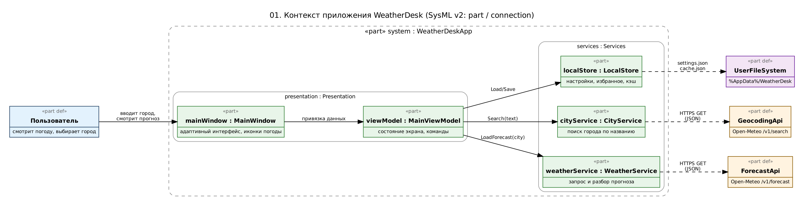
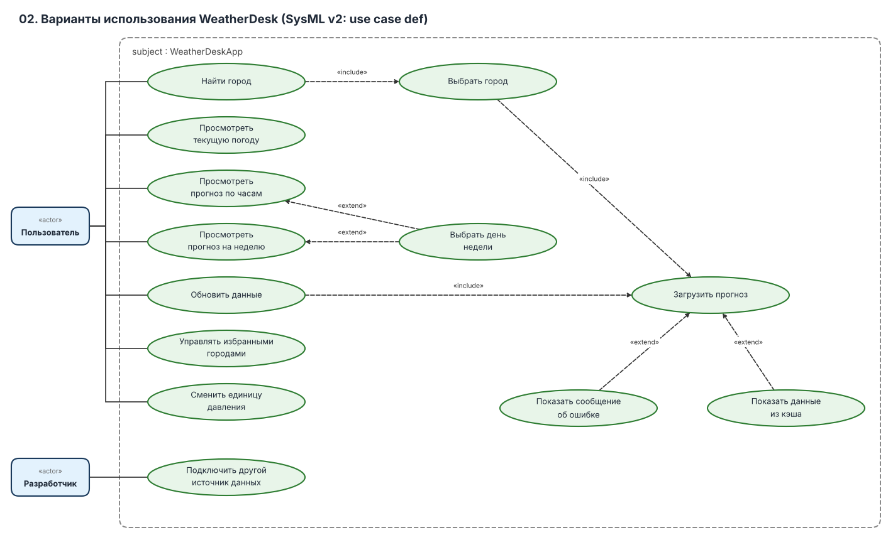
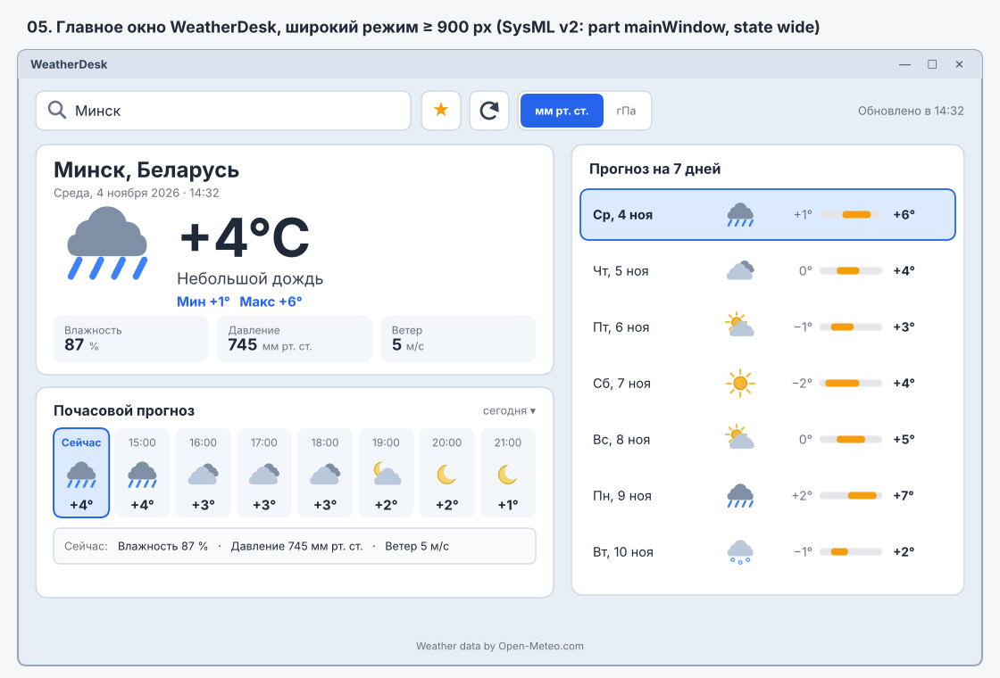
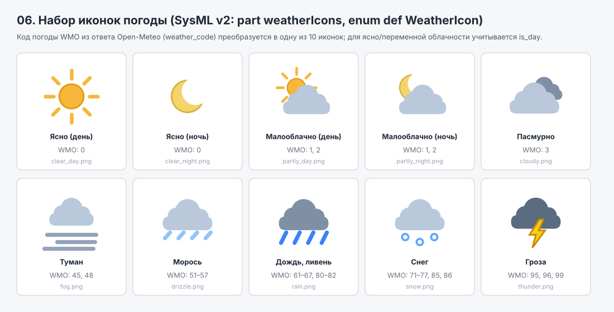
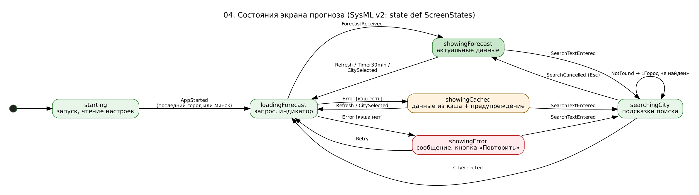
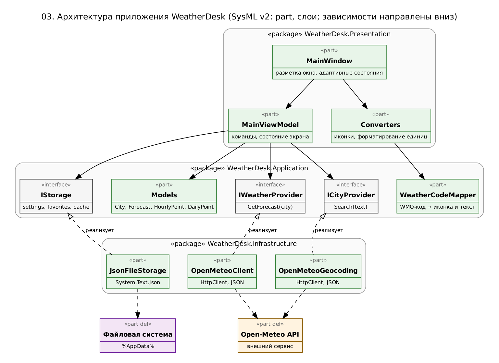

# Спецификация требований к ПО

Для приложения «WeatherDesk» (десктопное приложение прогноза погоды)

Версия 0.1

Подготовил Бавбель С.Л., гр. 450501

БГУИР, кафедра электронных вычислительных машин

04.11.2026

## Оглавление

<!-- TOC -->
* [1. Введение](#1-introduction)
  * [1.1 Назначение документа](#11-document-purpose)
  * [1.2 Область применения продукта](#12-product-scope)
  * [1.3 Определения, акронимы и сокращения](#13-definitions-acronyms-and-abbreviations)
  * [1.4 Ссылки](#14-references)
  * [1.5 Обзор документа](#15-document-overview)
* [2. Обзор продукта](#2-product-overview)
  * [2.1 Перспектива продукта](#21-product-perspective)
  * [2.2 Функции продукта](#22-product-functions)
  * [2.3 Ограничения продукта](#23-product-constraints)
  * [2.4 Характеристики пользователей](#24-user-characteristics)
  * [2.5 Допущения и зависимости](#25-assumptions-and-dependencies)
  * [2.6 Распределение требований](#26-apportioning-of-requirements)
* [3. Требования](#3-requirements)
  * [3.1 Внешние интерфейсы](#31-external-interfaces)
    * [3.1.1 Пользовательские интерфейсы](#311-user-interfaces)
    * [3.1.2 Аппаратные интерфейсы](#312-hardware-interfaces)
    * [3.1.3 Программные интерфейсы](#313-software-interfaces)
  * [3.2 Функциональные требования](#32-functional)
  * [3.3 Качество обслуживания](#33-quality-of-service)
    * [3.3.1 Производительность](#331-performance)
    * [3.3.2 Безопасность](#332-security)
    * [3.3.3 Надёжность](#333-reliability)
    * [3.3.4 Доступность](#334-availability)
    * [3.3.5 Наблюдаемость](#335-observability)
  * [3.4 Соответствие стандартам](#34-compliance)
  * [3.5 Проектирование и реализация](#35-design-and-implementation)
    * [3.5.1 Установка](#351-installation)
    * [3.5.2 Сборка и поставка](#352-build-and-delivery)
    * [3.5.3 Распределение](#353-distribution)
    * [3.5.4 Сопровождаемость](#354-maintainability)
    * [3.5.5 Повторное использование](#355-reusability)
    * [3.5.6 Переносимость](#356-portability)
    * [3.5.7 Стоимость](#357-cost)
    * [3.5.8 Сроки](#358-deadline)
    * [3.5.9 Доказательство концепции](#359-proof-of-concept)
    * [3.5.10 Управление изменениями](#3510-change-management)
  * [3.6 ИИ/МО](#36-aiml)
* [4. Верификация](#4-verification)
* [5. Приложения](#5-appendixes)
<!-- TOC -->

## История изменений

| Name | Date | Reason For Changes | Version |
|------|------|--------------------|---------|
| С.Л. Бавбель | 04.11.2026 | Первая редакция по бизнес-требованиям Заказчика | 0.1 |
|      |      |                    |         |

## 1. Введение {#1-introduction}

Документ описывает требования к десктопному приложению «WeatherDesk», которое показывает прогноз погоды для выбранного города по данным внешнего сервиса Open-Meteo (разработка на C# в JetBrains Rider). Он написан для Заказчика, разработчика, тестировщика и преподавателя. Бизнес-цели и границы продукта приведены в разделе 1.2, ограничения и пользователи в разделе 2, проверяемые требования в разделе 3.

### 1.1 Назначение документа {#11-document-purpose}

SRS определяет, **что** приложение должно делать, а не **как** оно будет реализовано. Заказчик использует его, чтобы подтвердить, что требования отражают его потребности. Разработчик берёт из него требования к проектированию и реализации, тестировщик строит по нему приёмочные тесты (раздел 4). Связанные артефакты: исходный код проекта, `README.md` репозитория, графические модели в каталоге `diagrams/`.

### 1.2 Область применения продукта {#12-product-scope}

**Продукт:** приложение «WeatherDesk», версия 0.1, самостоятельное десктопное приложение (Windows) без собственного сервера.

**Назначение.** Приложение позволяет выбрать город и посмотреть для него текущую погоду, прогноз по часам на ближайшие сутки и прогноз на неделю. Для каждого периода отображаются температура (минимальная и максимальная за день), влажность, атмосферное давление и скорость ветра; текущая погода сопровождается картинкой (солнце, дождь, облака и т. д.). Данные о погоде запрашиваются параллельно у трёх независимых внешних сервисов (Open-Meteo, Open-Meteo Archive/ECMWF и Met Norway — конкретный состав фиксируется в OQ-10); отображаются усреднённые значения, рассчитанные по правилам REQ-FUNC-020 … REQ-FUNC-022. Пользователь может видеть, сколько источников ответило и насколько велик разброс (REQ-INT-010). Интерфейс адаптируется к размеру окна. Запоминание последнего города — отключаемая настройка (REQ-FUNC-004).
**Бизнес-цели (источник: Заказчик):**

| ID | Бизнес-цель | Измеримый результат |
|----|-------------|---------------------|
| BO-1 | Пользователь быстро узнаёт актуальную погоду в нужном городе | После выбора города прогноз отображается не более чем через 3 секунды |
| BO-2 | Пользователь планирует ближайшие сутки и неделю | На экране доступны почасовой прогноз на 24 часа и прогноз на 7 дней |
| BO-3 | Приложением удобно пользоваться в окнах разного размера | При ширине окна от 400 px данные не обрезаются и нет горизонтальной прокрутки страницы |
| BO-4 | Приложение работает без собственного сервера и платных ключей | Используется только бесплатный API без ключа, нагрузка укладывается в лимиты сервиса |
| BO-5 | Приложение служит основой для учебного проекта: понятная структура, возможность расширения | Источник данных можно заменить без изменения интерфейса (REQ-MAINT-003) |

**Входит в область:** выбор города (поиск по названию, избранное), текущая погода с иконкой, прогноз по часам, прогноз на 7 дней, отображение минимальной и максимальной температуры, влажности, давления и скорости ветра, адаптивный интерфейс, обновление данных, локальное хранение настроек и кэша, параллельный опрос трёх погодных API, усреднение показателей.

**Не входит в область:** автоматическое определение местоположения, карты осадков и радар, погодные предупреждения и уведомления, история погоды за прошедшие дни, виджеты и значок в трее, веб- и мобильная версии, учётные записи пользователей, собственный серверный компонент, локализация интерфейса на другие языки.

### 1.3 Определения, акронимы и сокращения {#13-definitions-acronyms-and-abbreviations}

| Term | Definition |
|------|------------|
| API | Application Programming Interface — набор определений и протоколов для интеграции ПО |
| Open-Meteo | Бесплатный сервис погодных данных (прогноз и геокодинг), доступный по HTTPS без ключа для некоммерческого использования |
| Геокодинг | Преобразование названия населённого пункта в географические координаты |
| WMO-код | Числовой код погодных условий (`weather_code`) в ответе Open-Meteo, по стандарту ВМО; сопоставляется с иконкой и текстом (приложение C) |
| гПа | Гектопаскаль, единица давления; 1 мм рт. ст. = 1,33322 гПа |
| мм рт. ст. | Миллиметр ртутного столба, привычная в Беларуси единица атмосферного давления |
| Адаптивная вёрстка | Изменение расположения элементов интерфейса в зависимости от ширины окна |
| Кэш | Сохранённый на диске последний успешно полученный прогноз; используется при отсутствии сети |
| Избранное | Список городов, сохранённых пользователем для быстрого выбора |
| MVVM | Model–View–ViewModel — шаблон разделения интерфейса, состояния экрана и данных |
| .NET | Платформа разработки и выполнения приложений на C# |
| JSON | JavaScript Object Notation — текстовый формат обмена данными |
| xUnit | Библиотека модульного тестирования для .NET |
| SRS | Software Requirements Specification — документ, описывающий назначение, требования и характер ПО |
| SysML v2 | Systems Modeling Language версии 2 — язык моделирования, используемый для графической части документа |
| TBD | To Be Determined — значение ещё не согласовано с Заказчиком |
| UI | User Interface — визуальная часть приложения |

### 1.4 Ссылки {#14-references}

| № | Источник | Тип | Расположение |
|---|----------|-----|--------------|
| 1 | Источники и виды требований, ЖЦРПО Ч1 (СЭО БГУИР) | Справочная | `Источники_и_виды_требований.html` |
| 2 | Open-Meteo: Weather Forecast API (параметры `current`, `hourly`, `daily`, единицы измерения) | Нормативная | https://open-meteo.com/en/docs |
| 3 | Open-Meteo: Geocoding API (поиск города по названию) | Нормативная | https://open-meteo.com/en/docs/geocoding-api |
| 4 | Open-Meteo: Terms & Privacy (лимиты, лицензия CC BY 4.0, атрибуция) | Нормативная | https://open-meteo.com/en/terms |
| 5 | Creative Commons Attribution 4.0 International (CC BY 4.0) | Справочная | https://creativecommons.org/licenses/by/4.0/ |
| 6 | OMG Systems Modeling Language (SysML) v2 | Справочная | https://www.omg.org/sysml/sysmlv2/ |
| 7 | Графические модели SysML v2 (исходники `.sysml` и PNG) | Нормативная | `diagrams/` |
| 8 | Репозиторий проекта WeatherDesk (создан в лабораторной работе №2), ветка `lab3-srs` | Нормативная | репозиторий студента |
| 9 | Open-Meteo: ECMWF / Historical Forecast API (второй источник) | Нормативная | https://open-meteo.com/en/docs |
| 10 | Met Norway: Locationforecast API (третий источник, требуется User-Agent с контактом) | Нормативная | https://api.met.no/weatherapi/locationforecast/2.0/documentation |
### 1.5 Обзор документа {#15-document-overview}

Раздел 2 даёт контекст: место приложения среди внешних сервисов, функции, ограничения, пользователи, допущения и распределение требований по итерациям. Раздел 3 содержит требования с уникальными идентификаторами `REQ-[AREA]-[NNN]`; ключевое слово «должен» означает обязательное требование, «следует» означает рекомендацию. Раздел 4 связывает каждое требование со способом проверки. Раздел 5 содержит открытые вопросы к Заказчику, список графических моделей и таблицу соответствия кодов погоды иконкам. Каждое изменение документа фиксируется в истории изменений.

---

## 2. Обзор продукта {#2-product-overview}

### 2.1 Перспектива продукта {#21-product-perspective}

WeatherDesk — новое самостоятельное приложение, которое не входит в состав других систем. Оно состоит из окна интерфейса и набора служб (получение прогноза, поиск города, локальное хранилище). Приложение обращается по HTTPS к трём погодным сервисам (параллельно, REQ-INT-010) и к сервису геокодинга (REQ-INT-008). Собственного сервера и базы данных нет. При недоступности одного из погодных сервисов приложение продолжает работу по данным остальных (REQ-REL-005).

*Рисунок 1 — контекст приложения (SysML v2: `diagrams/01-context.sysml`).*

Границы владения: данные о погоде принадлежат Open-Meteo (приложение только отображает их с указанием источника), настройки и кэш принадлежат пользователю и хранятся локально.

### 2.2 Функции продукта {#22-product-functions}

1. Поиск города по названию и выбор из списка подсказок; настройка «Запоминать последний город» (вкл./выкл.); избранные города.
2. Отображение текущей погоды: получение данных из трех источников, температура, описание, иконка, влажность, давление, скорость ветра, минимальная и максимальная температура за сегодня.
3. Почасовой прогноз на 24 часа с возможностью посмотреть детали выбранного часа.
4. Прогноз на 7 дней с минимальной и максимальной температурой и иконкой; выбор дня показывает его почасовой прогноз.
5. Переключение единицы давления (мм рт. ст. / гПа).
6. Обновление данных вручную и автоматически; показ сохранённых данных при отсутствии сети.
7. Адаптивный интерфейс для окон разной ширины.
8. Информирование пользователя о загрузке и ошибках.

Варианты использования показаны на рисунке 2.

*Рисунок 2 — варианты использования (SysML v2: `diagrams/02-use-cases.sysml`).*

### 2.3 Ограничения продукта {#23-product-constraints}

| ID | Ограничение | Тип |
|----|-------------|-----|
| CON-1 | Приложение должно быть написано на C# (платформа .NET 8 LTS); средство разработки — JetBrains Rider | Внешнее, обязательное (Заказчик) |
| CON-2 | Приложение должно быть десктопным (оконным), для Windows 10/11 | Внешнее, обязательное (Заказчик) |
| CON-3 | Данные о погоде должны поступать через внешний API; собственный серверный компонент не создаётся | Внешнее, обязательное (Заказчик) |
| CON-4 | Используется бесплатный API Open-Meteo без ключа; необходимо соблюдать условия сервиса: менее 10 000 запросов в сутки, некоммерческое использование, указание источника (CC BY 4.0) | Внешнее, обязательное |
| CON-5 | Настройки и кэш хранятся локально в файлах JSON; база данных не используется | Внутреннее, предпочтительное |
| CON-6 | Лицензии используемых библиотек и иконок должны допускать использование в открытом учебном репозитории | Внешнее, обязательное |
| CON-7 | Код должен соответствовать правилам стиля C# (файл `.editorconfig`, проверки Rider); изменения поставляются через pull-request | Организационное, обязательное |
| CON-8 | Все три погодных сервиса должны быть бесплатными и не требовать платного ключа; суммарная нагрузка не должна превышать лимиты каждого сервиса (для Met Norway — обязательный User-Agent с контактом разработчика) | Внешнее, обязательное |
Конкретная библиотека построения интерфейса (WPF или Avalonia) в этом документе не фиксируется и выбирается при проектировании (см. OQ-1).

### 2.4 Характеристики пользователей {#24-user-characteristics}

| Класс | Описание | Частота | Особенности |
|-------|----------|---------|-------------|
| Пользователь | Любой человек, которому нужен прогноз погоды на ПК | Несколько раз в день | Не технический пользователь; работает мышью и клавиатурой; окно может быть узким (рядом с другими окнами) или развёрнутым; ожидает русский интерфейс и мм рт. ст. |
| Разработчик | Студент, развивающий проект в рамках курса | Регулярно | Знает C#; нужны понятная структура проекта и точка замены источника данных |

Локализация: язык интерфейса — русский; названия городов поступают от сервиса на русском языке (см. OQ-4).

### 2.5 Допущения и зависимости {#25-assumptions-and-dependencies}

| ID | Допущение / зависимость | Влияние, если неверно |
|----|-------------------------|-----------------------|
| AS-1 | У пользователя есть доступ в интернет при запуске и обновлении данных | Показывается кэш с предупреждением или сообщение об ошибке (REQ-FUNC-017, REQ-FUNC-018) |
| AS-2 | Формат ответов Open-Meteo (поля `current`, `hourly`, `daily`) остаётся совместимым | Разбор данных нужно обновить; приложение не должно аварийно завершаться (REQ-REL-002) |
| AS-3 | Сервис Open-Meteo доступен, но не даёт гарантий доступности (SLA отсутствует) | Возможны временные ошибки; обрабатываются по REQ-FUNC-018 |
| AS-4 | Экран пользователя не меньше 1024×768 px | Для меньших экранов интерфейс работает в компактном режиме (REQ-INT-002) |
| AS-5 | Приложение используется некоммерческим образом в рамках учебного курса | Для коммерческого использования потребуется платный план сервиса (CON-4) |

### 2.6 Распределение требований {#26-apportioning-of-requirements}

Трассируемость требований Заказчика (источник: бизнес-интервью):

| № | Требование Заказчика                                                                    | Требования SRS |
|---|-----------------------------------------------------------------------------------------|----------------|
| C-1 | Десктопное приложение, среда разработки JetBrains Rider, язык C#                        | CON-1, CON-2, REQ-PORT-001, REQ-INST-001, REQ-MAINT-001 |
| C-2 | Данные поступают через 3 внешних API                                                    | REQ-INT-007, REQ-INT-008, REQ-SEC-001, REQ-SEC-002, REQ-REL-002, REQ-COMP-001 |
| C-3 | Прогноз погоды по часам                                                                 | REQ-FUNC-008, REQ-FUNC-009 |
| C-4 | Выбор города                                                                            | REQ-FUNC-001 … REQ-FUNC-004, REQ-INT-008 |
| C-5 | Отображение минимальной и максимальной температуры, влажности, давления, скорости ветра | REQ-FUNC-006, REQ-FUNC-007, REQ-FUNC-009, REQ-FUNC-010, REQ-FUNC-012 |
| C-6 | Прогноз на неделю                                                                       | REQ-FUNC-010, REQ-INT-007 |
| C-7 | Картинки, отображающие текущую погоду (дождь, солнце и т. д.)                           | REQ-INT-004, REQ-FUNC-013 |
| C-8 | Адаптивная вёрстка интерфейса                                                           | REQ-INT-001 … REQ-INT-003 |

Инициативы исполнителя (добавлены сверх исходного описания, объём ограничен учебным характером проекта; **требуют подтверждения Заказчика**):

| № | Инициатива | Требования SRS |
|---|------------|----------------|
| P-1 | Избранные города | REQ-FUNC-005 |
| P-2 | Выбор дня недели и просмотр его почасового прогноза | REQ-FUNC-011 |
| P-3 | Переключение единицы давления (мм рт. ст. / гПа) | REQ-FUNC-012 |
| P-4 | Ручное и автоматическое обновление, время обновления | REQ-FUNC-014, REQ-FUNC-015, REQ-FUNC-016 |
| P-5 | Кэш и показ сохранённых данных без сети | REQ-FUNC-017, REQ-INT-009 |
| P-6 | Отображение времени в часовом поясе выбранного города | REQ-FUNC-019 |
| P-7 | Работа с клавиатуры | REQ-INT-006 |
| P-8 | Устойчивость, ограничение частоты запросов, журнал ошибок | REQ-REL-001 … REQ-REL-004, REQ-OBS-001, REQ-SEC-002, REQ-SEC-003 |

Распределение по итерациям:

| Итерация | Состав                                                                                          | Требования |
|----------|-------------------------------------------------------------------------------------------------|------------|
| 1 (доказательство концепции) | Консольный прототип: запрос прогноза Open-Meteo и разбор ответа                                 | REQ-POC-001 |
| 2 (ядро) | Модели данных, 3 клиента API, преобразование кодов и единиц, хранилище, кэш                     | REQ-INT-007 … REQ-INT-009, REQ-FUNC-012 … REQ-FUNC-013, REQ-FUNC-017 … REQ-FUNC-019, REQ-SEC-*, REQ-REL-* |
| 3 (интерфейс) | Окно, поиск и выбор города, карточки погоды, иконки, адаптивность, настройка запоминания города | REQ-INT-001 … REQ-INT-006, REQ-FUNC-001 … REQ-FUNC-011, REQ-FUNC-014 … REQ-FUNC-016 |
| 4 (качество) | Производительность, журнал, тесты, сборка, лицензии                                             | REQ-PERF-*, REQ-OBS-*, REQ-COMP-*, REQ-MAINT-*, REQ-PORT-001, REQ-INST-001 |

Отложено: тёмная тема (OQ-8), направление ветра, вероятность осадков и ощущаемая температура (OQ-5), автоматическое определение города (OQ-9).

---

## 3. Требования {#3-requirements}

Каждое требование содержит поля: **ID**, **Statement**, **Rationale**, **Acceptance Criteria**, **Verification Method** (Test, Analysis, Inspection, Demonstration). Источник по умолчанию — Заказчик; ссылки вида C-N и P-N указывают на таблицы в разделе 2.6.

### 3.1 Внешние интерфейсы {#31-external-interfaces}

#### 3.1.1 Пользовательские интерфейсы {#311-user-interfaces}

*Рисунок 3 — главное окно.*

*Рисунок 4 — подсказки поиска, загрузка, ошибки и работа без сети.*

*Рисунок 5 — набор иконок погоды и соответствующие коды WMO.*

**REQ-INT-001 — Структура главного окна**
- **Statement:** Главное окно должно содержать: строку поиска города; кнопки «Избранное», «Обновить» и переключатель единицы давления; время последнего обновления; карточку текущей погоды; блок почасового прогноза; блок прогноза на 7 дней; подпись об источнике данных.
- **Rationale:** Все функции, запрошенные Заказчиком, доступны с одного экрана без переходов (C-3 … C-7).
- **Acceptance Criteria:** В окне присутствуют все перечисленные элементы, расположенные как на рисунке 3; перехода на другие экраны для просмотра прогноза не требуется.
- **Verification Method:** Demonstration
- **More Information:** `diagrams/05-ui-main.png`.

**REQ-INT-002 — Адаптивная вёрстка**
- **Statement:** Интерфейс должен автоматически переключаться между тремя режимами по ширине окна: широкий (от 900 px, две колонки: слева текущая погода и почасовой прогноз, справа прогноз на неделю), средний (600–899 px, одна колонка, показатели справа от температуры) и компактный (менее 600 px, одна колонка, показатели под температурой).
- **Rationale:** Заказчик требует адаптивную вёрстку (C-8); окно приложения может быть любого размера.
- **Acceptance Criteria:** При плавном изменении ширины окна 1100 → 700 → 450 → 1100 px режим меняется на границах 900 и 600 px без перезапуска и без потери выбранного города и дня; во всех режимах отображаются одни и те же данные; макет соответствует рисунку 3.
- **Verification Method:** Test
- **More Information:** `diagrams/05-ui-main.png`.

**REQ-INT-003 — Минимальный размер окна**
- **Statement:** Минимальный размер окна должен быть 400×600 px; при любой допустимой ширине страница не должна иметь горизонтальной прокрутки, а текст и значения не должны обрезаться. Исключение — список часов, который прокручивается горизонтально внутри своего блока.
- **Rationale:** Обеспечивает удобство в узких окнах (BO-3).
- **Acceptance Criteria:** Окно нельзя уменьшить менее 400×600 px; при ширине 400 px все значения читаемы, горизонтальная полоса прокрутки окна отсутствует; прокрутка внутри блока часов работает мышью и колесом с Shift.
- **Verification Method:** Test

**REQ-INT-004 — Иконки погоды**
- **Statement:** Текущая погода, каждая карточка часа и каждая строка дня должны сопровождаться иконкой из набора из 10 изображений (ясно днём, ясно ночью, малооблачно днём, малооблачно ночью, пасмурно, туман, морось, дождь, снег, гроза); иконка выбирается по REQ-FUNC-013. Размер иконки: в карточке текущей погоды не менее 96×96 px, в карточках часов и строках дней не менее 32×32 px.
- **Rationale:** Заказчик требует картинки, отображающие текущую погоду (C-7).
- **Acceptance Criteria:** Для каждого из 28 поддерживаемых кодов WMO отображается иконка согласно приложению C; иконки видны без подключения к интернету (встроены в приложение); размеры соответствуют требованию.
- **Verification Method:** Test
- **More Information:** `diagrams/06-weather-icons.png`.

**REQ-INT-005 — Состояния интерфейса**
- **Statement:** Интерфейс должен показывать состояния: загрузка (индикатор и текст «Загрузка прогноза…»), город не найден, нет сети при наличии кэша (предупреждение с временем данных), нет сети при отсутствии кэша (сообщение и кнопка «Повторить»), ошибка сервиса (сообщение и кнопка «Повторить»).
- **Rationale:** Пользователь должен понимать, что происходит и что делать дальше (P-5, P-8).
- **Acceptance Criteria:** Каждое из состояний воспроизводится (отключением сети, вводом несуществующего города, подменой ответа сервиса ошибкой 503) и выглядит как на рисунке 5; тексты сообщений не содержат технических подробностей (стек вызовов, коды исключений).
- **Verification Method:** Demonstration
- **More Information:** `diagrams/05-ui-states.png`, `diagrams/04-states.png`.

**REQ-INT-006 — Работа с клавиатуры**
- **Statement:** Все элементы управления должны быть доступны с клавиатуры (Tab, Shift+Tab, Enter, Space); при запуске фокус находится в строке поиска; клавиши ↑/↓ и Enter выбирают подсказку, Esc закрывает список подсказок, F5 запускает обновление.
- **Rationale:** Удобство работы без мыши; доступность интерфейса (P-7).
- **Acceptance Criteria:** Весь сценарий «ввести город → выбрать подсказку → обновить» выполняется только с клавиатуры; порядок Tab соответствует визуальному порядку элементов.
- **Verification Method:** Test

#### 3.1.2 Аппаратные интерфейсы {#312-hardware-interfaces}

Аппаратных интерфейсов нет. Приложение не использует датчики, GPS и другие устройства; сетевое подключение используется на уровне операционной системы.

#### 3.1.3 Программные интерфейсы {#313-software-interfaces}

**REQ-INT-007 — Получение прогноза**
- **Statement:** Приложение должно получать данные запросом `GET https://api.open-meteo.com/v1/forecast` с параметрами: `latitude`, `longitude`, `current=temperature_2m,relative_humidity_2m,surface_pressure,wind_speed_10m,weather_code,is_day`, `hourly=temperature_2m,relative_humidity_2m,surface_pressure,wind_speed_10m,weather_code,is_day`, `daily=weather_code,temperature_2m_max,temperature_2m_min`, `wind_speed_unit=ms`, `timezone=auto`, `forecast_days=7`. Для одной загрузки данных выполняется один запрос.
- **Rationale:** Один запрос содержит всё необходимое: текущую погоду, прогноз по часам (до 168 значений) и по дням (7 значений); единицы м/с и °C совпадают с требуемыми (C-3, C-5, C-6).
- **Acceptance Criteria:** Для координат Минска (53.90, 27.57) ответ имеет статус 200, содержит блоки `current`, `hourly` (168 значений) и `daily` (7 значений); разбор ответа выполняется без ошибок; давление приходит в гПа.
- **Verification Method:** Test
- **More Information:** Выбор между давлением на уровне местности (`surface_pressure`) и приведённым к уровню моря (`pressure_msl`) требует подтверждения (OQ-2).

**REQ-INT-008 — Поиск города**
- **Statement:** Приложение должно получать список городов запросом `GET https://geocoding-api.open-meteo.com/v1/search` с параметрами `name` (введённый текст), `count=5`, `language=ru`, `format=json`; для каждого результата используются название, регион, страна, координаты и часовой пояс.
- **Rationale:** Пользователь выбирает город по названию, а прогноз запрашивается по координатам (C-4).
- **Acceptance Criteria:** Для запроса «Минск» список содержит город в Беларуси с координатами около 53.90, 27.57; для пустого результата приложение показывает сообщение «Город не найден» (REQ-FUNC-018).
- **Verification Method:** Test

**REQ-INT-009 — Локальное хранилище**
- **Statement:** Приложение должно хранить настройки (последний город, избранные города, единица давления) в файле `settings.json`, а прогнозы для последних 10 городов — в файле `cache.json` в каталоге `%AppData%/WeatherDesk`; файлы должны быть в кодировке UTF-8.
- **Rationale:** Настройки сохраняются между запусками, кэш позволяет показать данные без сети (P-5).
- **Acceptance Criteria:** После выбора города и перезапуска приложения выбранный город и единица давления восстанавливаются; файлы являются корректным JSON и открываются текстовым редактором.
- **Verification Method:** Test

### 3.2 Функциональные требования {#32-functional}

Диаграмма состояний экрана:

*Рисунок 7 — состояния экрана (SysML v2: `diagrams/04-states.sysml`).*

**REQ-FUNC-001 — Поиск города**
- **Statement:** При вводе в строку поиска не менее 2 символов приложение должно через 400 мс после последнего нажатия клавиши запросить варианты городов (REQ-INT-008) и показать не более 5 вариантов, каждый с названием, регионом и страной.
- **Rationale:** Заказчику нужен выбор города; задержка снижает число запросов (C-4, REQ-REL-003).
- **Acceptance Criteria:** При вводе «Мин» (3 символа) показывается список вариантов; при вводе одного символа запрос не отправляется; при быстром наборе слова отправляется один запрос после паузы.
- **Verification Method:** Test

**REQ-FUNC-002 — Выбор города**
- **Statement:** При выборе города из списка (щелчком или Enter) приложение должно закрыть список, показать название города в карточке текущей погоды и загрузить его прогноз.
- **Rationale:** Основной сценарий пользователя (C-4).
- **Acceptance Criteria:** После выбора города все блоки (текущая погода, часы, неделя) относятся к выбранному городу; данные другого города не отображаются.
- **Verification Method:** Test

**REQ-FUNC-003 — Город по умолчанию**
- **Statement:** При первом запуске, или если настройка "Запоминать последний город" выключена, когда сохранённых настроек нет, приложение должно загрузить прогноз для Минска (широта 53.90, долгота 27.57).
- **Rationale:** Экран не должен быть пустым при первом запуске.
- **Acceptance Criteria:** После удаления `settings.json` запуск приложения показывает прогноз для Минска без действий пользователя.
- **Verification Method:** Demonstration
- **More Information:** Город по умолчанию подлежит подтверждению (по умолчанию — Минск).

**REQ-FUNC-004 — Запоминание города**
- **Statement:** Приложение должно сохранять последний выбранный город и при следующем запуске автоматически загружать его прогноз, если настройка "Запоминать последний город" включена.
- **Rationale:** Пользователю не нужно выбирать город каждый раз.
- **Acceptance Criteria:** Выбрать «Гродно», закрыть приложение, запустить снова — отображается прогноз для Гродно.
- **Verification Method:** Test

**REQ-FUNC-005 — Избранные города**
- **Statement:** Приложение должно позволять добавить текущий город в избранное и удалить его кнопкой «★»; список избранных (не более 10) должен показываться при установке фокуса в пустую строку поиска, выбор города из списка загружает его прогноз.
- **Rationale:** Быстрый переход между часто используемыми городами (P-1).
- **Acceptance Criteria:** Кнопка «★» у города в избранном выделена цветом; после добавления 11-го города показывается сообщение о достижении предела; избранное сохраняется после перезапуска.
- **Verification Method:** Test
- **Source:** Исполнитель (P-1), требует подтверждения Заказчика.

**REQ-FUNC-006 — Текущая погода**
- **Statement:** Карточка текущей погоды должна показывать: название города и страну, местную дату и время, усредненную температуру (°C, округлённую до целого, со знаком), текстовое описание погоды, иконку, влажность (%), атмосферное давление и скорость ветра (м/с, округлённая до целого).
- **Rationale:** Основная информация для пользователя (C-5, C-7).
- **Acceptance Criteria:** Значения совпадают с блоком `current` ответа сервиса с учётом округления и единиц; поля располагаются как на рисунке 3.
- **Verification Method:** Test

**REQ-FUNC-007 — Минимальная и максимальная температура дня**
- **Statement:** В карточке текущей погоды должны отображаться минимальная и максимальная температура за сегодняшний день (первое значение блока `daily`).
- **Rationale:** Заказчик требует отображение минимальной и максимальной температуры (C-5).
- **Acceptance Criteria:** Подпись «Мин +1° Макс +6°» соответствует значениям `temperature_2m_min[0]` и `temperature_2m_max[0]` ответа; значения округлены до целого.
- **Verification Method:** Test

**REQ-FUNC-008 — Почасовой прогноз**
- **Statement:** Блок почасового прогноза должен показывать 24 часа, начиная с текущего часа; первая карточка подписана «Сейчас», остальные — временем «ЧЧ:мм». Каждая карточка содержит время, иконку и температуру.
- **Rationale:** Заказчик требует прогноз по часам (C-3).
- **Acceptance Criteria:** Блок содержит 24 карточки; порядок и значения совпадают с массивом `hourly` ответа, начиная с текущего часа города; при нехватке ширины список прокручивается горизонтально.
- **Verification Method:** Test

**REQ-FUNC-009 — Детали часа**
- **Statement:** При выборе карточки часа приложение должно показывать под списком влажность, давление и скорость ветра для этого часа; по умолчанию выбрана карточка «Сейчас».
- **Rationale:** Показатели, запрошенные Заказчиком, доступны не только для текущего момента, но и для каждого часа (C-3, C-5).
- **Acceptance Criteria:** После выбора карточки 18:00 в строке деталей отображаются значения влажности, давления и ветра за 18:00 согласно ответу сервиса.
- **Verification Method:** Test

**REQ-FUNC-010 — Прогноз на неделю**
- **Statement:** Блок прогноза на неделю должен показывать 7 дней, начиная с сегодняшнего; для каждого дня указываются день недели и дата, иконка, минимальная и максимальная температура.
- **Rationale:** Заказчик требует прогноз на неделю (C-6, C-5).
- **Acceptance Criteria:** Блок содержит 7 строк; даты идут подряд начиная с текущей даты города; значения совпадают с блоком `daily` ответа с учётом округления.
- **Verification Method:** Test

**REQ-FUNC-011 — Выбор дня недели**
- **Statement:** При выборе строки дня в прогнозе на неделю блок почасового прогноза должен показывать 24 часа выбранного дня, начиная с 00:00, а заголовок блока — день недели и дату; выбор сегодняшнего дня возвращает прогноз «от текущего часа».
- **Rationale:** Пользователь может посмотреть почасовой прогноз на любой день недели; данные уже есть в ответе (P-2).
- **Acceptance Criteria:** После выбора строки «Чт, 5 ноя» блок часов показывает значения за 00:00–23:00 этого дня; выбранная строка выделена; повторный выбор «Ср, 4 ноя» возвращает прежний вид.
- **Verification Method:** Test
- **Source:** Исполнитель (P-2), требует подтверждения Заказчика.

**REQ-FUNC-012 — Единицы измерения**
- **Statement:** Температура должна отображаться в °C, влажность в %, скорость ветра в м/с; давление — в мм рт. ст. по умолчанию с возможностью переключения на гПа переключателем в окне; выбранная единица должна сохраняться. Перевод выполняется по формуле: мм рт. ст. = гПа ÷ 1,33322, округление до целого.
- **Rationale:** В Беларуси давление принято указывать в мм рт. ст.; переключатель делает приложение удобным и тем, кто привык к гПа (P-3, C-5).
- **Acceptance Criteria:** 1013 гПа отображается как 760 мм рт. ст.; 745 мм рт. ст. после переключения отображается как 993 гПа; после перезапуска сохраняется выбранная единица.
- **Verification Method:** Test

**REQ-FUNC-013 — Код погоды, иконка и описание**
- **Statement:** Приложение должно преобразовывать WMO-код (`weather_code`) и признак дня (`is_day`) в иконку (REQ-INT-004) и русское описание по таблице приложения C; для неизвестного кода должны использоваться иконка «пасмурно» и описание «Нет данных».
- **Rationale:** Пользователю нужно понятное представление кода погоды (C-7).
- **Acceptance Criteria:** Для каждого из 28 кодов таблицы результат совпадает с таблицей; для кода 0 при `is_day=0` выбирается иконка «ясно ночью»; для кода 123 — «Нет данных».
- **Verification Method:** Test

**REQ-FUNC-014 — Обновление вручную**
- **Statement:** Нажатие кнопки «Обновить» или клавиши F5 должно запрашивать данные для текущего города заново; пока выполняется запрос, повторные нажатия игнорируются, а между успешными запросами должно проходить не менее 10 секунд.
- **Rationale:** Пользователь может получить свежие данные; ограничение защищает сервис от лишней нагрузки (P-4, REQ-REL-003).
- **Acceptance Criteria:** Нажатие «Обновить» приводит к одному запросу и обновлению времени «Обновлено в …»; десять быстрых нажатий подряд приводят не более чем к одному запросу.
- **Verification Method:** Test
- **Source:** Исполнитель (P-4), требует подтверждения Заказчика.

**REQ-FUNC-015 — Автоматическое обновление**
- **Statement:** Пока приложение запущено, оно должно автоматически обновлять данные текущего города каждые 30 минут; обновление не должно закрывать список подсказок, менять выбранный день и сбрасывать прокрутку списка часов.
- **Rationale:** Данные не устаревают при длительной работе (P-4).
- **Acceptance Criteria:** При интервале, уменьшенном до 1 минуты в тестовой конфигурации, данные обновляются автоматически; выбранный день недели остаётся выбранным.
- **Verification Method:** Test
- **Source:** Исполнитель (P-4), требует подтверждения Заказчика.

**REQ-FUNC-016 — Время обновления**
- **Statement:** В окне должна отображаться подпись «Обновлено в ЧЧ:мм» со временем последнего успешного получения данных по часам компьютера.
- **Rationale:** Пользователь видит актуальность данных (P-4).
- **Acceptance Criteria:** После успешного обновления подпись меняется на текущее время; при показе кэша указывается время получения кэшированных данных (REQ-FUNC-017).
- **Verification Method:** Test
- **Source:** Исполнитель (P-4).

**REQ-FUNC-017 — Обработка ошибок**
- **Statement:** Приложение должно обрабатывать ошибки без аварийного завершения: город не найден, нет сети, таймаут запроса (10 секунд), HTTP-ошибки сервиса, некорректный JSON; для каждого случая должно показываться понятное сообщение (REQ-INT-005), а подробности ошибки — записываться в журнал (REQ-OBS-001).
- **Rationale:** Внешний сервис и сеть ненадёжны; пользователь не должен видеть аварийное завершение (P-8).
- **Acceptance Criteria:** Для каждого из пяти случаев приложение продолжает работать, показывает сообщение по рисунку 5, в журнале появляется запись.
- **Verification Method:** Test

**REQ-FUNC-018 — Местное время города**
- **Statement:** Даты и время в блоках текущей погоды, почасового и недельного прогнозов должны отображаться в часовом поясе выбранного города (параметр `timezone=auto`), а не в часовом поясе компьютера.
- **Rationale:** Пользователь, смотрящий погоду в другом часовом поясе, должен видеть корректные «сейчас» и часы (P-6).
- **Acceptance Criteria:** Для Токио в карточке указано местное время Токио; первая карточка часа соответствует текущему часу в Токио.
- **Verification Method:** Test
- **Source:** Исполнитель (P-6), требует подтверждения Заказчика.

### 3.3 Качество обслуживания {#33-quality-of-service}

#### 3.3.1 Производительность {#331-performance}

**REQ-PERF-001 — Время отображения прогноза**
- **Statement:** После выбора города прогноз должен отображаться не более чем через 3 секунды для 95% запросов при доступности сервиса и скорости соединения не менее 5 Мбит/с.
- **Rationale:** BO-1: пользователь не должен долго ждать.
- **Acceptance Criteria:** При 20 последовательных выборах разных городов не менее 19 раз прогноз показан за 3 секунды или быстрее (измерение от выбора города до отображения карточки).
- **Verification Method:** Test

**REQ-PERF-002 — Отзывчивость интерфейса**
- **Statement:** Сетевые операции должны выполняться асинхронно и не блокировать интерфейс; реакция интерфейса на действия пользователя во время запроса должна быть не более 200 мс; таймаут HTTP-запроса — 10 секунд.
- **Rationale:** Окно не должно «зависать» при медленной сети.
- **Acceptance Criteria:** При искусственной задержке ответа сервиса 8 секунд окно можно перемещать и изменять в размере, поле поиска принимает ввод; запрос с задержкой более 10 секунд завершается сообщением об ошибке.
- **Verification Method:** Test

#### 3.3.2 Безопасность {#332-security}

**REQ-SEC-001 — Только HTTPS**
- **Statement:** Все обращения к внешним сервисам должны выполняться по протоколу HTTPS; запросы по HTTP не должны выполняться.
- **Rationale:** Защита передаваемых данных (C-2).
- **Acceptance Criteria:** В коде и сетевом журнале нет обращений по `http://`; адреса сервисов задаются схемой `https`.
- **Verification Method:** Inspection

**REQ-SEC-002 — Безопасная обработка ввода**
- **Statement:** Длина текста поиска должна быть ограничена 100 символами, а при формировании запроса параметры должны кодироваться (URL-кодирование); специальные символы не должны нарушать формат запроса.
- **Rationale:** Ввод пользователя нельзя подставлять в адрес без обработки (P-8).
- **Acceptance Criteria:** Ввод `Минск&count=1000#` не изменяет параметры запроса: в запросе значение `name` содержит введённую строку целиком в закодированном виде; ввод 150 символов обрезается до 100.
- **Verification Method:** Test

**REQ-SEC-003 — Отсутствие персональных данных и секретов**
- **Statement:** Приложение не должно собирать и передавать персональные данные: в запросах к сервисам передаются только название города, координаты и технические параметры; геолокация операционной системы не используется; ключи и пароли в репозитории отсутствуют.
- **Rationale:** Минимизация данных, безопасность репозитория (P-8).
- **Acceptance Criteria:** Анализ сетевого трафика показывает только перечисленные параметры; поиск по репозиторию не находит ключей и секретов.
- **Verification Method:** Inspection

#### 3.3.3 Надёжность {#333-reliability}

**REQ-REL-001 — Повреждённые файлы данных**
- **Statement:** Если `settings.json` или `cache.json` повреждён или отсутствует, приложение должно запуститься с настройками по умолчанию; повреждённый файл должен быть переименован с суффиксом `.bad`.
- **Rationale:** Файл может быть изменён вручную или повреждён при сбое (P-8).
- **Acceptance Criteria:** При содержимом файла `{{{` приложение запускается, показывает Минск, рядом появляется `settings.json.bad`.
- **Verification Method:** Test

**REQ-REL-002 — Неполные данные сервиса**
- **Statement:** Если в ответе сервиса значение отсутствует или равно `null`, приложение должно показывать «—» вместо значения и продолжать отображать остальные данные.
- **Rationale:** Сервис может не иметь части показателей (AS-2).
- **Acceptance Criteria:** Для ответа, где `relative_humidity_2m` равно `null` для одного часа, в соответствующей карточке показано «—», остальные значения и блоки отображаются корректно.
- **Verification Method:** Test

**REQ-REL-003 — Ограничение частоты запросов**
- **Statement:** Приложение не должно отправлять более 60 запросов к сервисам в час с одного компьютера в штатном режиме (подсказки не чаще одного запроса за 400 мс, автообновление раз в 30 минут, ручное — по REQ-FUNC-014).
- **Rationale:** Соблюдение условий бесплатного сервиса (CON-4).
- **Acceptance Criteria:** При часовом тестовом сценарии активного использования число запросов не превышает 60.
- **Verification Method:** Test

**REQ-REL-004 — Устаревшие ответы**
- **Statement:** Если пользователь выбрал другой город до завершения предыдущего запроса, результат предыдущего запроса не должен заменять данные нового города.
- **Rationale:** Иначе на экране окажется прогноз не того города (P-8).
- **Acceptance Criteria:** При задержке ответа для города A в 5 секунд и быстром выборе города B на экране остаётся прогноз города B после завершения запроса A.
- **Verification Method:** Test

#### 3.3.4 Доступность {#334-availability}

Собственных серверных компонентов нет, поэтому доступность определяется доступностью сервиса Open-Meteo и сети пользователя. При недоступности сервиса поведение определено в REQ-FUNC-017 и REQ-FUNC-018.

#### 3.3.5 Наблюдаемость {#335-observability}

**REQ-OBS-001 — Журнал ошибок**
- **Statement:** Приложение должно записывать ошибки сети, разбора и работы с файлами в журнал `%AppData%/WeatherDesk/logs/app.log` с указанием времени, уровня и описания; размер файла не должен превышать 1 МБ, хранится не более 3 файлов.
- **Rationale:** Подробности ошибок нужны разработчику, но не показываются пользователю (P-8).
- **Acceptance Criteria:** После отключения сети и попытки обновления в журнале появляется запись с временем и описанием; при превышении 1 МБ создаётся новый файл, старых остаётся не более трёх.
- **Verification Method:** Inspection

### 3.4 Соответствие стандартам {#34-compliance}

**REQ-COMP-001 — Указание источника данных**
- **Statement:** В главном окне должна постоянно отображаться подпись «Weather data by Open-Meteo.com» со ссылкой на `https://open-meteo.com`; в окне «О программе» должно быть указано, что данные распространяются на условиях CC BY 4.0.
- **Rationale:** Условие использования бесплатного API (CON-4).
- **Acceptance Criteria:** Подпись видна во всех режимах (рисунки 3 и 4); щелчок по ней открывает сайт Open-Meteo в браузере.
- **Verification Method:** Inspection

**REQ-COMP-002 — Лицензии компонентов**
- **Statement:** Все сторонние библиотеки и изображения должны иметь лицензию, допускающую использование в учебном проекте (MIT, Apache-2.0, BSD, CC0, CC BY или собственные работы); список с лицензиями должен храниться в `docs/licenses.md`.
- **Rationale:** Юридическая чистота проекта (CON-6).
- **Acceptance Criteria:** Для каждого компонента из зависимостей проекта и каждой иконки в `docs/licenses.md` указаны источник и лицензия.
- **Verification Method:** Inspection

**REQ-COMP-003 — Стиль кода**
- **Statement:** Код должен соответствовать правилам стиля C# (`.editorconfig` в репозитории): PascalCase для типов и методов, camelCase для локальных переменных, префикс `I` для интерфейсов; инспекции Rider не должны показывать предупреждений уровня error.
- **Rationale:** Единый стиль упрощает сопровождение (CON-7).
- **Acceptance Criteria:** Инспекция решения в Rider («Inspect Code») не выдаёт замечаний уровня error; проверка форматирования проходит.
- **Verification Method:** Inspection

### 3.5 Проектирование и реализация {#35-design-and-implementation}

#### 3.5.1 Установка {#351-installation}

**REQ-INST-001 — Установка без прав администратора**
- **Statement:** Приложение должно поставляться архивом ZIP, запускаться из любой папки без установщика и без прав администратора; удаление приложения выполняется удалением папки.
- **Rationale:** Простота поставки учебного приложения.
- **Acceptance Criteria:** На чистой Windows 10 и Windows 11 после распаковки архива приложение запускается двойным щелчком по `WeatherDesk.exe` без установки дополнительных компонентов.
- **Verification Method:** Demonstration
- **More Information:** Для этого приложение публикуется как self-contained (с включённой средой выполнения .NET).

#### 3.5.2 Сборка и поставка {#352-build-and-delivery}

Сборка выполняется командой `dotnet build` из каталога решения или средствами Rider; публикация для поставки — `dotnet publish -c Release -r win-x64 --self-contained`. Поставляемый артефакт — архив ZIP с исполняемым файлом (REQ-INST-001). Отдельных требований к сборке сверх перечисленного нет.

#### 3.5.3 Распределение {#353-distribution}

Приложение распространяется через раздел Releases репозитория проекта в виде архива ZIP. Магазины приложений и автоматическое обновление не используются.

#### 3.5.4 Сопровождаемость {#354-maintainability}

Архитектура приложения показана на рисунке 8.

*Рисунок 8 — слои приложения (SysML v2: `diagrams/03-architecture.sysml`).*

**REQ-MAINT-001 — Слоистая архитектура**
- **Statement:** Приложение должно быть разделено на слои Presentation (окно, ViewModel, конвертеры), Application (модели, интерфейсы `IWeatherProvider`, `ICityProvider`, `IStorage`, преобразование кодов погоды) и Infrastructure (клиенты Open-Meteo, файловое хранилище); ViewModel не должна ссылаться на типы слоя Infrastructure.
- **Rationale:** Разделение упрощает тестирование и замену источника данных (C-1, BO-5).
- **Acceptance Criteria:** В проекте Presentation нет ссылок на сборку Infrastructure, кроме точки сборки зависимостей (composition root); проверка структуры зависимостей проходит.
- **Verification Method:** Inspection

**REQ-MAINT-002 — Модульные тесты**
- **Statement:** Для слоёв Application и Infrastructure должны быть написаны модульные тесты xUnit: разбор ответов API, преобразование кодов погоды, перевод единиц, работа кэша и настроек; покрытие строк этих слоёв — не менее 70%; все тесты должны проходить.
- **Rationale:** Проверяемость поведения и защита от регрессий.
- **Acceptance Criteria:** Команда `dotnet test` завершается успешно; отчёт покрытия показывает не менее 70% для указанных слоёв.
- **Verification Method:** Analysis

**REQ-MAINT-003 — Замена источника данных**
- **Statement:** Реализация `IWeatherProvider` должна заменяться без изменения кода ViewModel и окна.
- **Rationale:** Сценарий разработчика «Подключить другой источник данных» (BO-5).
- **Acceptance Criteria:** В тестовой конфигурации `OpenMeteoClient` заменён тестовой реализацией, возвращающей фиксированные данные; приложение показывает эти данные без изменений кода интерфейса.
- **Verification Method:** Demonstration

#### 3.5.5 Повторное использование {#355-reusability}

Повторное использование внешних компонентов допускается в соответствии с REQ-COMP-002. Специальных требований к повторному использованию собственного кода нет.

#### 3.5.6 Переносимость {#356-portability}

**REQ-PORT-001 — Поддерживаемая платформа**
- **Statement:** Приложение должно работать на 64-разрядных Windows 10 (версия 22H2) и Windows 11 при масштабировании экрана 100–200%.
- **Rationale:** Платформа указана Заказчиком (C-1, CON-2).
- **Acceptance Criteria:** Приложение запускается и корректно отображает интерфейс (без обрезания элементов) на Windows 10 и Windows 11 при масштабе 100%, 150% и 200%.
- **Verification Method:** Test
- **More Information:** Поддержка Linux и macOS возможна при выборе кроссплатформенного фреймворка (OQ-1), но не требуется в версии 0.1.

#### 3.5.7 Стоимость {#357-cost}

Разработка выполняется в учебных целях, используется бесплатный сервис без ключа и бесплатная версия средств разработки; денежных затрат нет.

#### 3.5.8 Сроки {#358-deadline}

Сроки определяются графиком лабораторных работ курса; разбиение на итерации приведено в разделе 2.6.

#### 3.5.9 Доказательство концепции {#359-proof-of-concept}

**REQ-POC-001 — Прототип получения данных**
- **Statement:** Должен быть создан консольный прототип, который получает прогноз Open-Meteo для Минска и выводит текущую температуру, температуру на ближайшие 24 часа и минимум/максимум на 7 дней.
- **Rationale:** До разработки интерфейса необходимо убедиться, что данные доступны в нужном виде (REQ-INT-007).
- **Acceptance Criteria:** Прототип запускается командой `dotnet run`, выводит значения, совпадающие со страницей Open-Meteo для тех же координат.
- **Verification Method:** Demonstration

#### 3.5.10 Управление изменениями {#3510-change-management}

Изменения требований вносятся в ветку документа и оформляются pull-request; каждое изменение фиксируется в истории изменений SRS. Требования, добавленные исполнителем (раздел 2.6), считаются предварительными до подтверждения Заказчиком.

### 3.6 ИИ/МО {#36-aiml}

Не применимо. Приложение не использует методы искусственного интеллекта и машинного обучения.

---

## 4. Верификация {#4-verification}

Тестовые данные: наборы ответов Open-Meteo (`normal`, `with-nulls`, `invalid-json`, `error-503`, `timeout`), города (`Минск`, `Гродно`, `Токио`, несуществующий `Мнскк`), состояния сети (есть, нет, медленная). Окружение: Windows 10 22H2 и Windows 11, разрешения экрана 1366×768 и 1920×1080, масштаб 100–200%.

| Requirement ID | Verification Method | Test/Artifact Link | Status | Evidence |
|----------------|---------------------|--------------------|--------|----------|
| REQ-INT-001 | Demonstration | tests/manual/main-window.md | Planned | |
| REQ-INT-002 | Test | tests/ui/AdaptiveLayoutTests | Planned | |
| REQ-INT-003 | Test | tests/ui/MinSizeTests | Planned | |
| REQ-INT-004 | Test | tests/ui/IconSetTests | Planned | |
| REQ-INT-005 | Demonstration | tests/manual/ui-states.md | Planned | |
| REQ-INT-006 | Test | tests/ui/KeyboardTests | Planned | |
| REQ-INT-007 | Test | tests/WeatherDesk.Tests/OpenMeteoClientTests | Planned | |
| REQ-INT-008 | Test | tests/WeatherDesk.Tests/GeocodingClientTests | Planned | |
| REQ-INT-009 | Test | tests/WeatherDesk.Tests/JsonFileStorageTests | Planned | |
| REQ-FUNC-001 | Test | tests/WeatherDesk.Tests/CitySearchTests | Planned | |
| REQ-FUNC-002 | Test | tests/ui/CitySelectionTests | Planned | |
| REQ-FUNC-003 | Demonstration | tests/manual/first-run.md | Planned | |
| REQ-FUNC-004 | Test | tests/WeatherDesk.Tests/LastCityTests | Planned | |
| REQ-FUNC-005 | Test | tests/WeatherDesk.Tests/FavoritesTests | Planned | |
| REQ-FUNC-006 | Test | tests/WeatherDesk.Tests/CurrentWeatherViewModelTests | Planned | |
| REQ-FUNC-007 | Test | tests/WeatherDesk.Tests/MinMaxTests | Planned | |
| REQ-FUNC-008 | Test | tests/WeatherDesk.Tests/HourlyForecastTests | Planned | |
| REQ-FUNC-009 | Test | tests/WeatherDesk.Tests/HourDetailsTests | Planned | |
| REQ-FUNC-010 | Test | tests/WeatherDesk.Tests/WeeklyForecastTests | Planned | |
| REQ-FUNC-011 | Test | tests/WeatherDesk.Tests/DaySelectionTests | Planned | |
| REQ-FUNC-012 | Test | tests/WeatherDesk.Tests/UnitConversionTests | Planned | |
| REQ-FUNC-013 | Test | tests/WeatherDesk.Tests/WeatherCodeMapperTests | Planned | |
| REQ-FUNC-014 | Test | tests/WeatherDesk.Tests/ManualRefreshTests | Planned | |
| REQ-FUNC-015 | Test | tests/WeatherDesk.Tests/AutoRefreshTests | Planned | |
| REQ-FUNC-016 | Test | tests/WeatherDesk.Tests/UpdatedLabelTests | Planned | |
| REQ-FUNC-017 | Test | tests/WeatherDesk.Tests/CacheTests | Planned | |
| REQ-FUNC-018 | Test | tests/WeatherDesk.Tests/ErrorHandlingTests | Planned | |
| REQ-FUNC-019 | Test | tests/WeatherDesk.Tests/LocalTimeTests | Planned | |
| REQ-PERF-001 | Test | tests/perf/ForecastLoadTime.md | Planned | |
| REQ-PERF-002 | Test | tests/ui/ResponsivenessTests | Planned | |
| REQ-PERF-003 | Test | tests/perf/Resources.md | Planned | |
| REQ-SEC-001 | Inspection | tests/review/https-only.md | Planned | |
| REQ-SEC-002 | Test | tests/WeatherDesk.Tests/InputEncodingTests | Planned | |
| REQ-SEC-003 | Inspection | tests/review/privacy.md | Planned | |
| REQ-REL-001 | Test | tests/WeatherDesk.Tests/CorruptedFilesTests | Planned | |
| REQ-REL-002 | Test | tests/WeatherDesk.Tests/NullValuesTests | Planned | |
| REQ-REL-003 | Test | tests/perf/RequestRate.md | Planned | |
| REQ-REL-004 | Test | tests/WeatherDesk.Tests/StaleResponseTests | Planned | |
| REQ-OBS-001 | Inspection | tests/review/logging.md | Planned | |
| REQ-COMP-001 | Inspection | tests/review/attribution.md | Planned | |
| REQ-COMP-002 | Inspection | docs/licenses.md | Planned | |
| REQ-COMP-003 | Inspection | Rider: Inspect Code | Planned | |
| REQ-INST-001 | Demonstration | tests/manual/clean-install.md | Planned | |
| REQ-MAINT-001 | Inspection | tests/review/layers.md | Planned | |
| REQ-MAINT-002 | Analysis | dotnet test + отчёт покрытия | Planned | |
| REQ-MAINT-003 | Demonstration | tests/manual/replace-provider.md | Planned | |
| REQ-PORT-001 | Test | tests/manual/windows-dpi.md | Planned | |
| REQ-POC-001 | Demonstration | poc/ConsoleForecast | Planned | |

---

## 5. Приложения {#5-appendixes}

### Приложение A. Открытые вопросы к Заказчику (TBD)

| ID | Вопрос | Предлагаемое решение по умолчанию | Затронутые требования |
|----|--------|-----------------------------------|-----------------------|
| OQ-1 | Какую библиотеку интерфейса использовать: WPF (только Windows) или Avalonia (также Linux и macOS)? | WPF, платформа Windows 10/11 | CON-2, REQ-INT-002, REQ-PORT-001 |
| OQ-2 | Показывать давление на уровне местности (`surface_pressure`) или приведённое к уровню моря (`pressure_msl`)? | На уровне местности, как в большинстве местных сервисов | REQ-INT-007, REQ-FUNC-006, REQ-FUNC-012 |
| OQ-3 | Подходит ли единица мм рт. ст. по умолчанию с переключением на гПа? | Да | REQ-FUNC-012 |
| OQ-4 | Нужен ли интерфейс на английском языке? | Нет, только русский | REQ-INT-001, REQ-FUNC-013 |
| OQ-5 | Нужны ли направление ветра, вероятность осадков, ощущаемая температура? | Нет, вне области версии 0.1 | REQ-FUNC-006, REQ-FUNC-009 |
| OQ-6 | Какие иконки использовать: собственные или готовый набор с открытой лицензией? | Собственные иконки (как на рисунке 6) | REQ-INT-004, REQ-COMP-002 |
| OQ-7 | Какой срок хранения кэша допустим? | 24 часа | REQ-FUNC-017 |
| OQ-8 | Нужна ли тёмная тема? | Нет, только светлая | REQ-INT-001 |
| OQ-9 | Нужно ли определять город пользователя автоматически? | Нет, город выбирается вручную | REQ-FUNC-003 |

### Приложение B. Графические модели SysML v2

Все диаграммы описаны в текстовой нотации SysML v2 (файлы `.sysml`), PNG-файлы подготовлены на основе этих моделей; макеты интерфейса (рисунки 3–5) показывают предполагаемый вид приложения, значения погоды на них приведены для иллюстрации.

| Рисунок | Назначение | PNG | Исходная модель |
|---------|------------|-----|-----------------|
| 1 | Контекст приложения | `diagrams/01-context.png` | `diagrams/01-context.sysml` |
| 2 | Варианты использования | `diagrams/02-use-cases.png` | `diagrams/02-use-cases.sysml` |
| 3 | Главное окно, широкий режим | `diagrams/05-ui-main.png` | `diagrams/05-ui-mockups.sysml` |
| 4 | Компактный и средний режимы | `diagrams/05-ui-adaptive.png` | `diagrams/05-ui-mockups.sysml` |
| 5 | Состояния интерфейса | `diagrams/05-ui-states.png` | `diagrams/05-ui-mockups.sysml` |
| 6 | Иконки погоды и коды WMO | `diagrams/06-weather-icons.png` | `diagrams/06-weather-icons.sysml` |
| 7 | Состояния экрана | `diagrams/04-states.png` | `diagrams/04-states.sysml` |
| 8 | Архитектура приложения | `diagrams/03-architecture.png` | `diagrams/03-architecture.sysml` |

### Приложение C. Соответствие кодов WMO иконкам и описаниям

Таблица используется в REQ-FUNC-013. Для кодов 0, 1 и 2 иконка зависит от признака `is_day`: днём — «день», ночью — «ночь».

| Код WMO | Описание | Иконка |
|---------|----------|--------|
| 0 | Ясно | `clear_day` / `clear_night` |
| 1 | Преимущественно ясно | `partly_day` / `partly_night` |
| 2 | Переменная облачность | `partly_day` / `partly_night` |
| 3 | Пасмурно | `cloudy` |
| 45 | Туман | `fog` |
| 48 | Изморозевый туман | `fog` |
| 51 | Слабая морось | `drizzle` |
| 53 | Умеренная морось | `drizzle` |
| 55 | Сильная морось | `drizzle` |
| 56 | Слабая ледяная морось | `drizzle` |
| 57 | Сильная ледяная морось | `drizzle` |
| 61 | Небольшой дождь | `rain` |
| 63 | Дождь | `rain` |
| 65 | Сильный дождь | `rain` |
| 66 | Слабый ледяной дождь | `rain` |
| 67 | Сильный ледяной дождь | `rain` |
| 71 | Небольшой снег | `snow` |
| 73 | Снег | `snow` |
| 75 | Сильный снег | `snow` |
| 77 | Снежные зёрна | `snow` |
| 80 | Небольшой ливень | `rain` |
| 81 | Ливень | `rain` |
| 82 | Сильный ливень | `rain` |
| 85 | Небольшой снегопад | `snow` |
| 86 | Сильный снегопад | `snow` |
| 95 | Гроза | `thunder` |
| 96 | Гроза с небольшим градом | `thunder` |
| 99 | Гроза с сильным градом | `thunder` |
